<div align="center">

# 🎧 HelpDeskPro

**Sistem tiket & helpdesk IT internal: lapor masalah, tangani, pantau SLA, sampai selesai.**


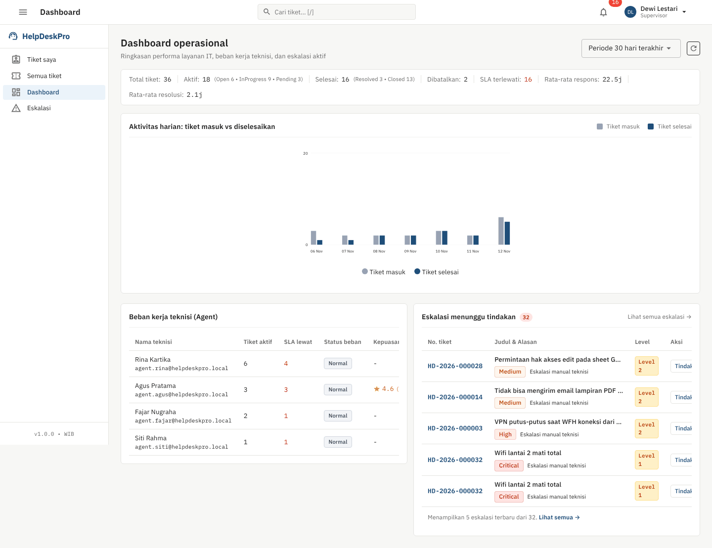

</div>

---

## 📑 Daftar isi

- [Apa itu HelpDeskPro?](#-apa-itu-helpdeskpro)
- [Mulai cepat (5 menit)](#-mulai-cepat-5-menit)
- [Akun demo](#-akun-demo)
- [Alur kerja tiket](#-alur-kerja-tiket)
- [Fitur & cara kerjanya](#-fitur--cara-kerjanya)
- [Hak akses per peran](#-hak-akses-per-peran)
- [Tampilan responsif](#-tampilan-responsif)
- [API & Swagger](#-api--swagger)
- [Arsitektur](#%EF%B8%8F-arsitektur)
- [Menjalankan secara manual](#-menjalankan-secara-manual)
- [Pengujian](#-pengujian)
- [Troubleshooting](#-troubleshooting)

---

## 💡 Apa itu HelpDeskPro?

HelpDeskPro adalah aplikasi **helpdesk IT internal perusahaan**. Karyawan melaporkan kendala (printer macet, WiFi mati, lupa password, permintaan akses, dan lain-lain) sebagai **tiket**. Tim IT kemudian **mengambil, mengerjakan, dan menyelesaikan** tiket tersebut. Setiap tiket punya batas waktu (**SLA**) yang dihitung otomatis berdasarkan jam kerja. Kalau batas waktu terlewati, sistem **mengeskalasi ke atasan secara otomatis**.

| | |
|---|---|
| 🎫 **Tiket terstruktur** | Nomor otomatis `HD-2026-000001`, kategori, prioritas, lampiran, komentar, riwayat lengkap |
| ⏱️ **SLA jam kerja** | Hanya menghitung Senin–Jumat 08.00–17.00 WIB, di luar hari libur, dan berhenti saat tiket *Pending* |
| 🚨 **Eskalasi otomatis** | Pemantau latar belakang tiap 5 menit menaikkan tiket yang lewat SLA ke Level 1 / Level 2 |
| 🔔 **Notifikasi** | Penugasan, komentar baru, perubahan status, eskalasi |
| ⭐ **Rating kepuasan** | Pelapor memberi bintang 1–5 dan tiket otomatis ditutup |
| 📊 **Dashboard** | Ringkasan, tren 7 hari, beban kerja teknisi, eskalasi aktif |
| 🔐 **4 peran** | Requester, Agent, Supervisor, Admin, masing-masing dengan hak akses berbeda |
| 📱 **Responsif** | Nyaman dipakai di desktop, tablet, dan ponsel |

---

## 🚀 Mulai cepat (5 menit)

**Prasyarat:** [.NET 8 SDK](https://dotnet.microsoft.com/download/dotnet/8.0), [Docker Desktop](https://www.docker.com/products/docker-desktop/) (pastikan sudah menyala), dan Git.

```bash
git clone https://github.com/akhmadrizaldy74/HelpDeskPro-Antigravity.git
cd HelpDeskPro-Antigravity
```

**Windows (PowerShell):**

```powershell
powershell -ExecutionPolicy Bypass -File .\start.ps1
```

**Linux / macOS:**

```bash
./start.sh
```

Skrip ini otomatis menjalankan langkah berikut:

1. Membuat file `.env` dan menyalakan **SQL Server** di Docker
2. **Build** seluruh solution satu kali
3. Menjalankan **API** (`http://localhost:5017`) dan menunggu sampai siap. Saat pertama kali, tabel dan data contoh dibuat otomatis
4. Menjalankan **Web** (`http://localhost:5015`) dan membuka browser

Setelah muncul tulisan **"Siap!"**, login dengan salah satu akun di bawah. Untuk berhenti, tutup jendela *HelpDeskPro API* & *HelpDeskPro Web*, lalu jalankan `docker compose stop`.

---

## 👤 Akun demo

Semua akun memakai password **`Dev@Passw0rd123!`**

| Peran | Email | Yang bisa dicoba |
|---|---|---|
| 🛠️ **Admin** | `admin@helpdeskpro.local` | Semua fitur + master data |
| 👔 **Supervisor** | `supervisor.it@helpdeskpro.local` | Dashboard, menugaskan teknisi, eskalasi |
| 🔧 **Agent** | `agent.agus@helpdeskpro.local` | Mengambil & menyelesaikan tiket |
| 🙋 **Requester** | `requester.bambang@helpdeskpro.local` | Membuat tiket & memberi rating |

Akun lain: `supervisor.ops@…`, `agent.rina@…`, `agent.fajar@…`, `agent.siti@…`, `requester.nurul@…` (semuanya `@helpdeskpro.local`).

---

## 🔄 Alur kerja tiket

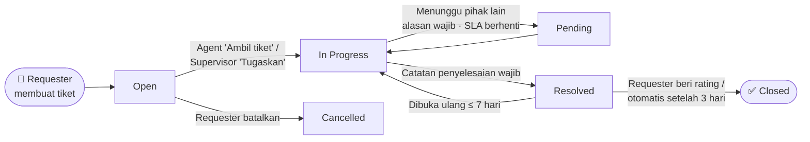

**Contoh skenario lengkap:**
1. **Bambang (Requester)** melaporkan *"Laptop tidak bisa terhubung ke WiFi"* dengan prioritas **High**. Sistem membuat nomor tiket dan menghitung target SLA.
2. **Agus (Agent)** melihat tiket di antrean, klik **Ambil tiket**, lalu status berubah ke **In Progress**.
3. Agus membalas Bambang dan menulis **catatan internal** untuk tim IT. Bambang tidak bisa melihat catatan internal itu.
4. Driver diperbarui, Agus mengubah status ke **Resolved** dengan catatan penyelesaian.
5. Bambang memberi **rating ⭐⭐⭐⭐⭐**, dan tiket otomatis **Closed**.
6. **Dewi (Supervisor)** memantau semuanya dari **Dashboard**. Kalau ada tiket yang lewat SLA, eskalasi muncul di halaman **Eskalasi**.

---

## ✨ Fitur & cara kerjanya

### 1. Login & keamanan

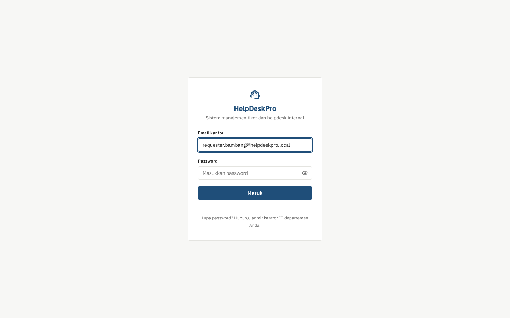

- Login memakai **email kantor + password**. API memverifikasi data lalu mengirim **token JWT** yang berlaku 8 jam dan berisi ID, nama, peran, dan departemen.
- Web menyimpan token di browser dan menyertakannya di setiap permintaan ke API. Kalau token habis, pengguna otomatis kembali ke halaman login.
- Semua halaman **wajib login**. Halaman yang tidak sesuai peran menampilkan **"Akses ditolak"**.
- Akun terkunci 15 menit setelah 5 kali salah password.

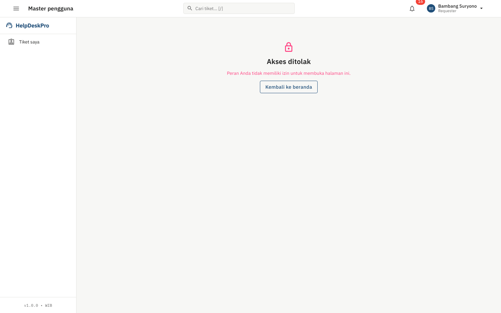

### 2. Membuat tiket

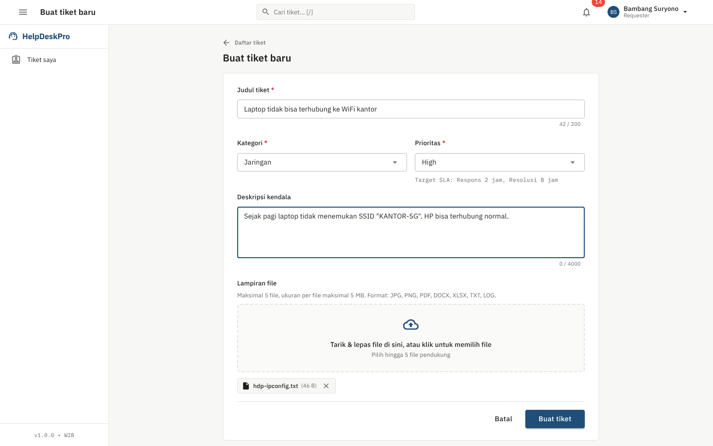

| Isian | Aturan |
|---|---|
| Judul | Wajib, 5–200 karakter |
| Kategori | Hardware, Software, Jaringan, Akses & Akun, Email, Printer (bisa diatur Admin) |
| Prioritas | Critical / High / Medium / Low. Target SLA langsung ditampilkan di bawahnya |
| Deskripsi | Opsional, maks. 4000 karakter |
| Lampiran | Maks. 5 file @ 5 MB · JPG, PNG, PDF, DOCX, XLSX, TXT, LOG |

Setelah disimpan, sistem membuat **nomor tiket berurutan per tahun** (`HD-2026-000036`), menghitung **batas respons & resolusi**, lalu membuka halaman detail.

> Pintasan: tekan **`N`** di mana saja untuk membuat tiket baru.

### 3. Daftar tiket

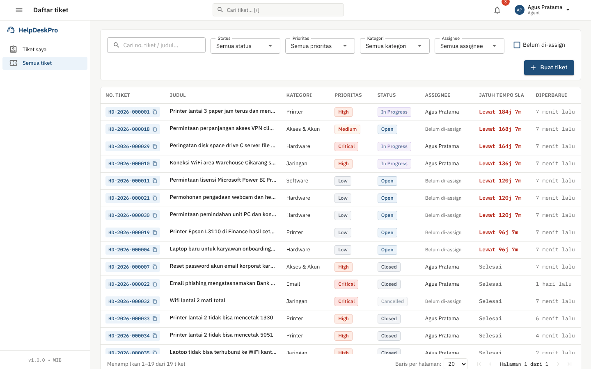

- **Filter** berdasarkan status (bisa lebih dari satu), prioritas, kategori, assignee, dan **"Belum di-assign"**. Filter tersimpan otomatis di browser.
- **Pencarian** nomor tiket atau judul. Kotak cari global di atas bisa dibuka dengan tombol **`/`**.
- Kolom **Jatuh tempo SLA** berwarna merah kalau sudah lewat.
- Klik nomor tiket untuk menyalinnya, dan klik baris untuk membuka detail.
- **"Tiket saya"** berarti tiket yang Anda buat (Requester) atau tiket yang ditugaskan ke Anda (staf IT).

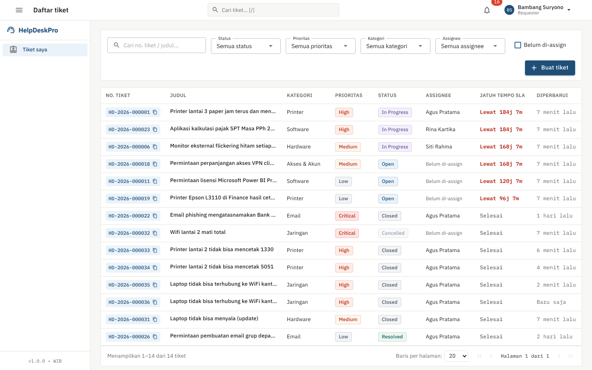

### 4. Detail tiket: komentar, lampiran, linimasa

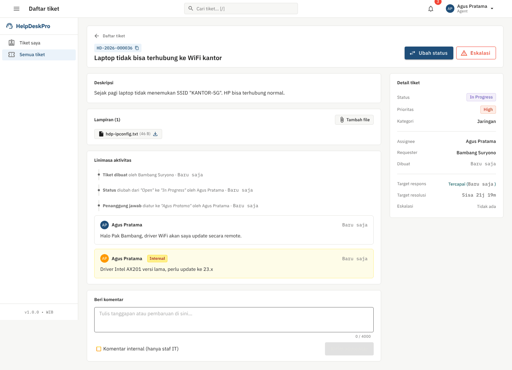

- **Panel kanan** berisi status, prioritas, kategori, penanggung jawab, pelapor, target respons/resolusi (sisa waktu atau "Lewat"), dan tingkat eskalasi.
- **Lampiran** bisa ditambah dan diunduh.
- **Linimasa** menggabungkan komentar dan riwayat perubahan (status, penanggung jawab, rating, dan lain-lain) secara berurutan.
- **Komentar internal** (latar kuning) hanya terlihat oleh staf IT. Komentar ini disaring di API, jadi Requester sama sekali tidak menerimanya.
- **Proteksi bentrok:** kalau dua orang mengubah tiket bersamaan, orang kedua mendapat pesan *"Tiket sudah diubah pengguna lain, muat ulang halaman"*, jadi tidak ada data yang tertimpa.

### 5. Mengambil, menugaskan & mengubah status

| Ambil / Tugaskan | Ubah status |
|---|---|
| 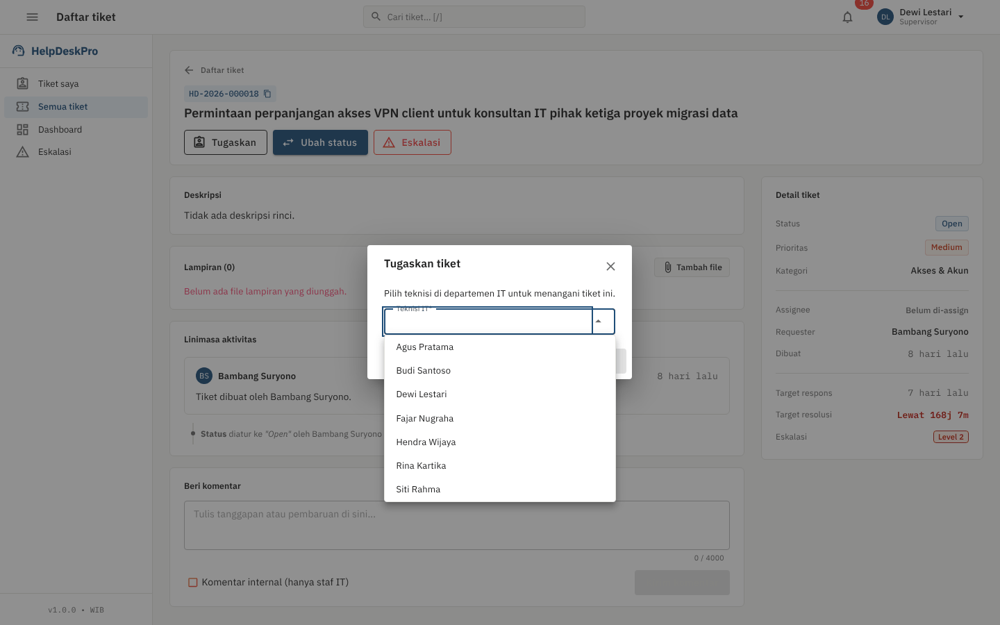 | 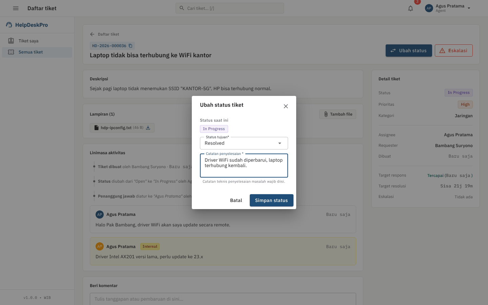 |

- **Agent** menekan **Ambil tiket** pada tiket yang belum ditugaskan. **Supervisor/Admin** memakai **Tugaskan** untuk memilih teknisi.
- Saat ditugaskan, tiket otomatis menjadi **In Progress** dan **waktu respons pertama** tercatat. Teknisi yang ditugaskan juga mendapat notifikasi.
- Dialog **Ubah status** hanya menampilkan perpindahan yang diizinkan:
  - **Pending**: alasan wajib diisi dan otomatis dicatat sebagai komentar internal. **Jam SLA berhenti** selama Pending.
  - **Resolved**: catatan penyelesaian wajib diisi.
  - **Dibuka ulang** (Resolved ke In Progress): maksimal 7 hari setelah selesai.
  - **Requester** hanya bisa membatalkan tiket yang masih *Open* dan menutup tiket yang sudah *Resolved*.

### 6. Rating kepuasan

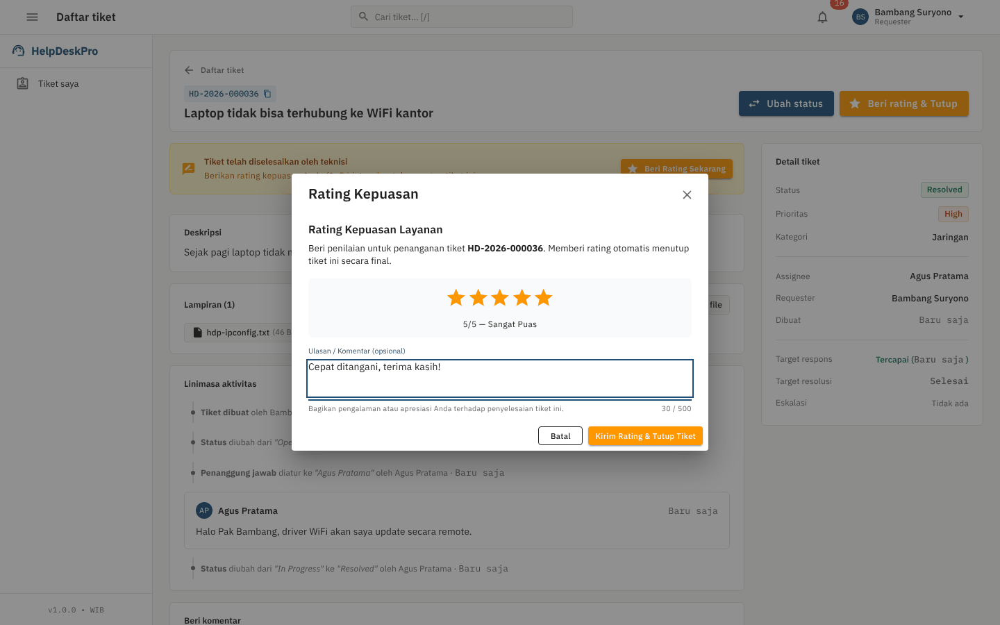

Saat tiket **Resolved**, Requester melihat tombol **"Beri rating & Tutup"**. Pilih bintang 1–5 dan tambahkan ulasan kalau mau, lalu tiket otomatis **Closed**. Rata-rata rating tiap teknisi muncul di Dashboard. Tiket Resolved yang tidak direspons selama **3 hari** ditutup otomatis oleh sistem.

### 7. SLA (Service Level Agreement)

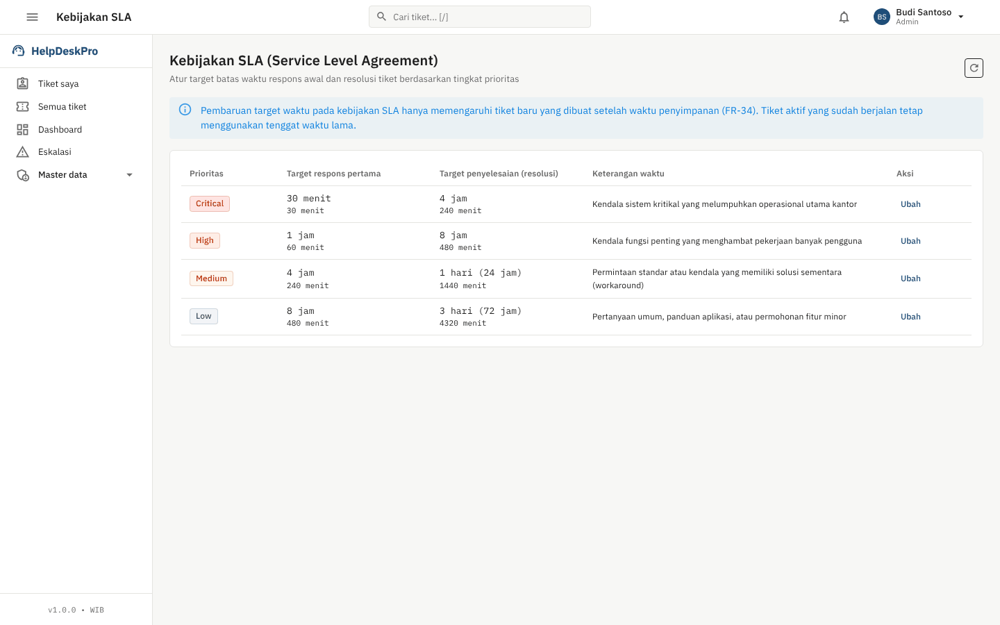

| Prioritas | Target respons | Target resolusi |
|---|---|---|
| 🔴 Critical | 30 menit | 4 jam |
| 🟠 High | 2 jam | 8 jam |
| 🟡 Medium | 4 jam | 24 jam |
| ⚪ Low | 8 jam | 72 jam |

- Waktu dihitung pada **jam kerja: Senin–Jumat 08.00–17.00 WIB**. Akhir pekan dan **hari libur nasional** dilewati.
- Contoh: tiket *High* dibuat Jumat 16.00. Target resolusi 8 jam kerja jatuh pada **Senin 15.00**.
- Admin bisa mengubah target. Perubahan hanya berlaku untuk tiket baru.

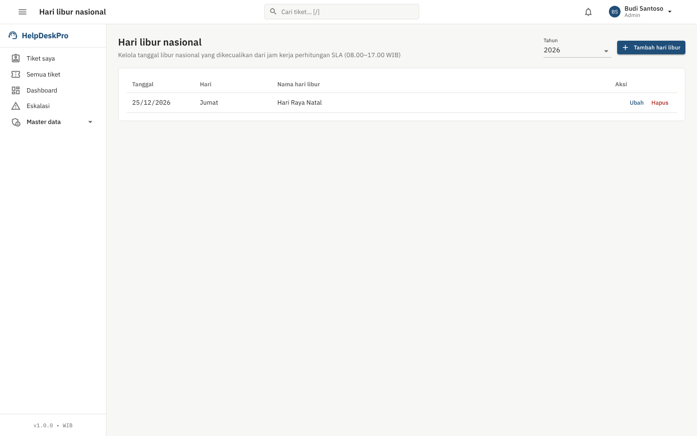

### 8. Eskalasi (otomatis & manual)

| Halaman eskalasi | Eskalasi manual |
|---|---|
| 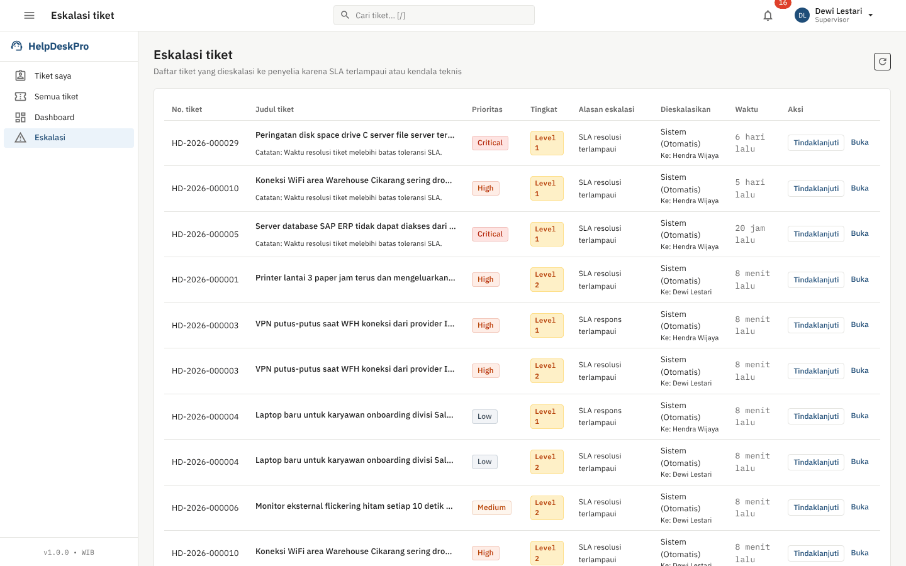 | 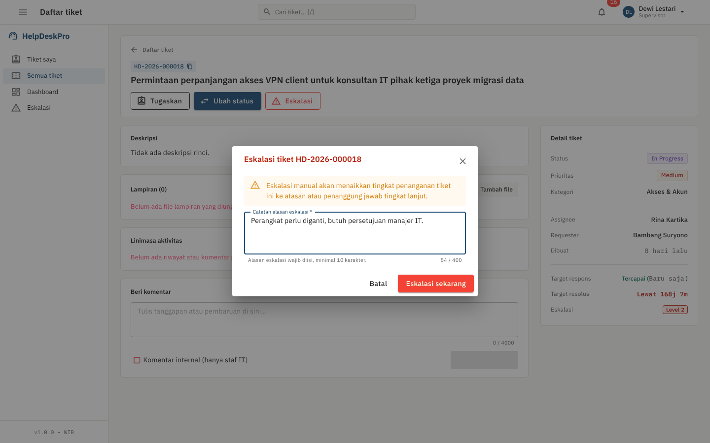 |

Di dalam API berjalan **pemantau SLA setiap 5 menit**:

| Kondisi | Tindakan |
|---|---|
| Tiket **belum direspons** melewati target respons | Eskalasi **Level 1** ke atasan langsung teknisi |
| Tiket **belum selesai** melewati target resolusi | Eskalasi **Level 2** ke atasan supervisor |
| Tiket **Resolved ≥ 3 hari** tanpa tanggapan | Ditutup otomatis |

- Setiap eskalasi hanya dibuat **sekali** per tiket per level, jadi tidak ada duplikat. Penerimanya juga mendapat notifikasi.
- **Eskalasi manual:** Agent/Supervisor menekan **Eskalasi** dan menulis catatan minimal 10 karakter.
- Penerima eskalasi menekan **Tindaklanjuti** setelah menanganinya.

### 9. Notifikasi

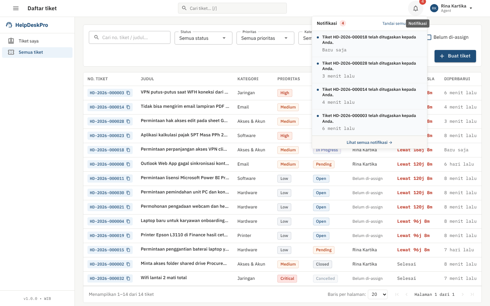

Ikon 🔔 menampilkan jumlah notifikasi yang belum dibaca. Notifikasi dikirim saat tiket **ditugaskan**, ada **komentar baru**, **status berubah**, atau terjadi **eskalasi**. Klik notifikasi untuk langsung membuka tiketnya, atau pakai **"Tandai semua dibaca"**.

### 10. Dashboard (Supervisor & Admin)


- **Ringkasan** periode 7 atau 30 hari: total tiket, tiket aktif, selesai, dibatalkan, tiket yang **lewat SLA**, serta rata-rata waktu respons dan resolusi.
- **Grafik harian** tiket masuk dibandingkan tiket selesai selama 7 hari terakhir (zona WIB).
- **Beban kerja teknisi**: jumlah tiket aktif, jumlah yang lewat SLA, status beban, dan rata-rata rating.
- **Eskalasi menunggu tindakan**: 5 terbaru, dengan tautan ke halaman lengkap.
- Supervisor dari departemen IT melihat semua data. Supervisor departemen lain hanya melihat data departemennya.

### 11. Master data (Admin)

| Pengguna | Tambah pengguna |
|---|---|
| 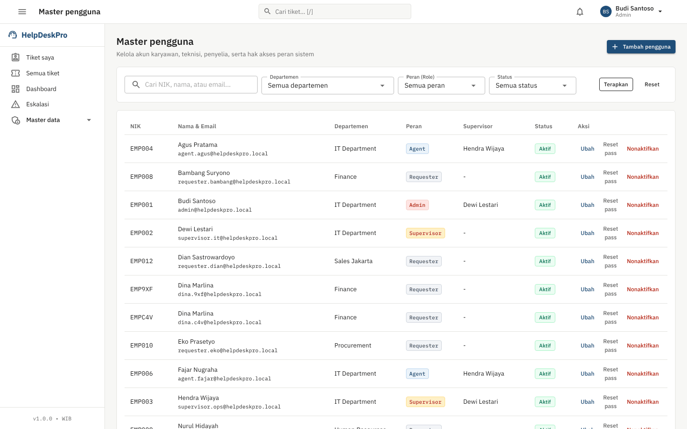 | 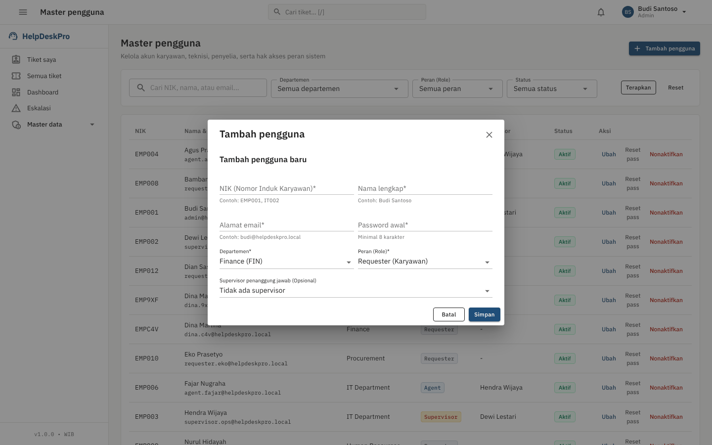 |
| **Departemen** | **Kategori** |
| 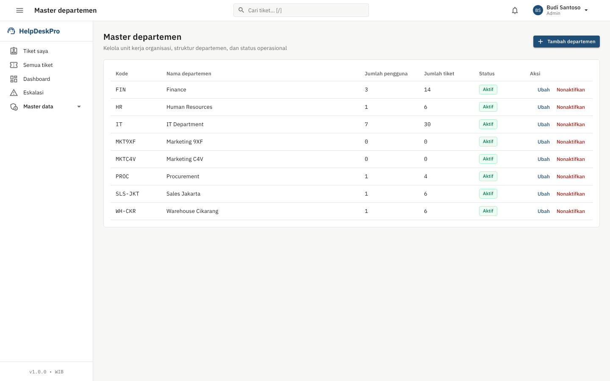 | 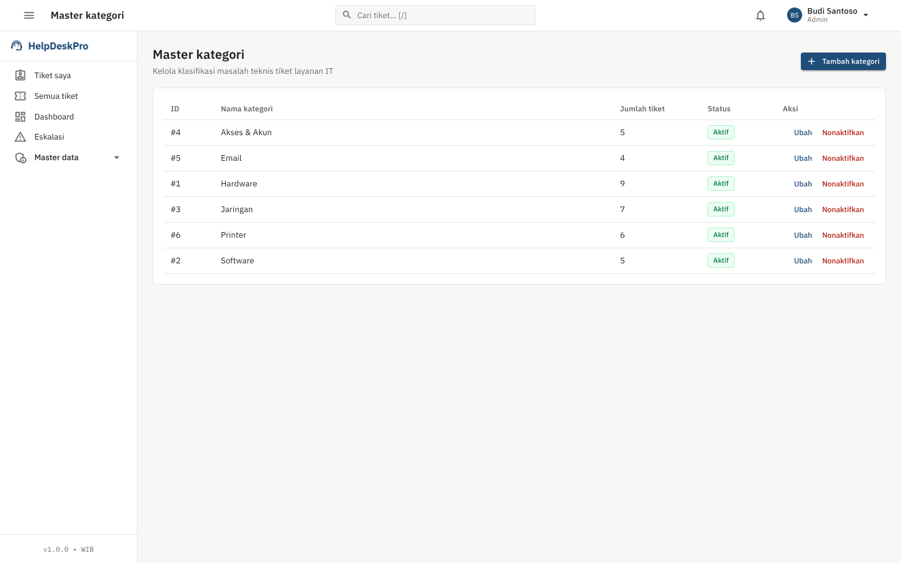 |

| Menu | Fungsi |
|---|---|
| **Pengguna** | Tambah akun (NIK, nama, email, password awal, departemen, peran, atasan), ubah, nonaktifkan, reset password, filter & cari |
| **Departemen** | Tambah / ubah / nonaktifkan unit kerja |
| **Kategori** | Tambah / ubah / nonaktifkan. Kategori yang sudah dipakai tiket tidak bisa dihapus, hanya dinonaktifkan |
| **Kebijakan SLA** | Ubah target respons & resolusi per prioritas |
| **Hari libur** | Daftar tanggal libur yang dikecualikan dari hitungan SLA |

---

## 🔐 Hak akses per peran

| Fitur | Requester | Agent | Supervisor | Admin |
|---|:---:|:---:|:---:|:---:|
| Buat tiket, komentar, lampiran | ✅ | ✅ | ✅ | ✅ |
| Lihat tiket | Milik sendiri | Ditugaskan ke saya + belum di-assign | Semua (IT) / departemennya | Semua |
| Komentar internal | ❌ | ✅ | ✅ | ✅ |
| Ambil tiket | ❌ | ✅ | ❌ | ❌ |
| Tugaskan ke teknisi | ❌ | ❌ | ✅ | ✅ |
| Ubah status | Batal / Tutup saja | ✅ | ✅ | ✅ |
| Eskalasi manual | ❌ | ✅ (Level 1) | ✅ (Level 2) | ✅ |
| Rating & tutup tiket | ✅ | ❌ | ❌ | ✅ |
| Dashboard & halaman Eskalasi | ❌ | ❌ | ✅ | ✅ |
| Master data | ❌ | ❌ | ❌ | ✅ |

Semua aturan ini diterapkan **di API**, bukan hanya di tampilan.

---

## 📱 Tampilan responsif

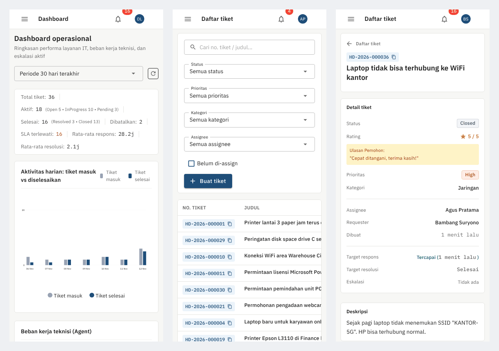

| Ukuran layar | Penyesuaian |
|---|---|
| **Desktop** (≥ 960px) | Menu samping tetap terbuka, detail tiket dua kolom |
| **Tablet** (600–959px) | Menu samping menjadi menu geser (☰), detail tiket satu kolom dengan panel status di atas |
| **Ponsel** (< 600px) | Top bar ringkas (judul, lonceng, avatar), filter satu kolom, tabel dapat digeser horizontal, kolom pelengkap disembunyikan, tombol aksi melebar, dialog selebar layar |

---

## 🔌 API & Swagger

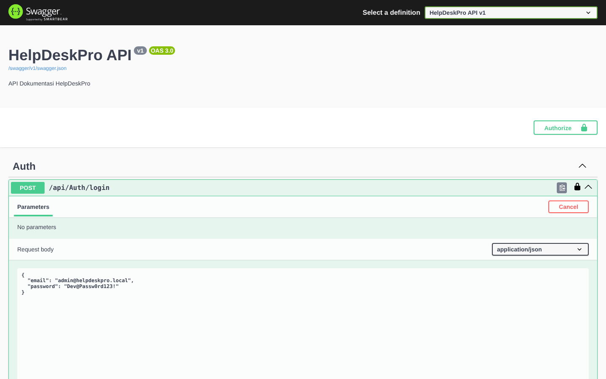

Dokumentasi interaktif tersedia di **http://localhost:5017/swagger**.

1. Buka **POST `/api/Auth/login`**. Body sudah terisi akun Admin.
2. Klik **Try it out**, lalu **Execute**. Token otomatis terpasang di tombol **Authorize** dan tetap tersimpan saat halaman di-refresh.
3. Endpoint lain langsung bisa dicoba.

<details>
<summary><b>Daftar endpoint utama</b></summary>

| Method | Endpoint | Keterangan |
|---|---|---|
| POST | `/api/auth/login` | Login, menghasilkan token JWT |
| GET | `/api/auth/me` | Profil pengguna yang login |
| GET | `/api/tickets` | Daftar tiket (filter, cari, halaman) |
| GET | `/api/tickets/filter-options` | Daftar kategori & teknisi untuk filter |
| POST | `/api/tickets` | Buat tiket |
| GET / PUT | `/api/tickets/{id}` | Detail / ubah tiket |
| PATCH | `/api/tickets/{id}/assign` | Tugaskan teknisi |
| PATCH | `/api/tickets/{id}/status` | Ubah status |
| POST | `/api/tickets/{id}/comments` | Tambah komentar |
| POST / GET | `/api/tickets/{id}/attachments[/{attachmentId}]` | Unggah / unduh lampiran |
| GET | `/api/tickets/{id}/history` | Riwayat perubahan |
| POST | `/api/tickets/{id}/escalate` | Eskalasi manual |
| POST | `/api/tickets/{id}/rate` | Rating & tutup |
| PATCH | `/api/escalations/{id}/acknowledge` | Tindaklanjuti eskalasi |
| GET / PATCH | `/api/notifications`, `/unread-count`, `/read-all` | Notifikasi |
| GET | `/api/dashboard/summary`, `/agent-workload`, `/pending-escalations`, `/ticket-trend` | Data dashboard |
| CRUD | `/api/master/{departments, categories, users, sla-policies, holidays}` | Master data (Admin) |

Format error mengikuti **ProblemDetails**: `400` validasi, `401` belum login, `403` tidak berhak, `404` tidak ditemukan, `409` bentrok data, `422` melanggar aturan bisnis.

</details>

---

## 🏗️ Arsitektur

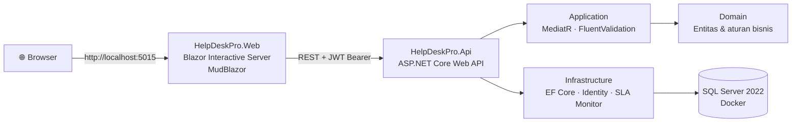

Proyek ini memakai **Clean Architecture**. Setiap fitur adalah satu *command* atau *query* MediatR yang divalidasi FluentValidation sebelum dijalankan.

```text
HelpDeskPro/
├── src/
│   ├── HelpDeskPro.Domain          # Entitas, enum, aturan transisi status, exception domain
│   ├── HelpDeskPro.Application     # Commands, Queries, DTO, Validator per fitur
│   ├── HelpDeskPro.Infrastructure  # EF Core, migration, Identity, JWT, SLA monitor, kalender kerja, file storage
│   ├── HelpDeskPro.Api             # Controller tipis, middleware error, Swagger
│   └── HelpDeskPro.Web             # UI Blazor (halaman, dialog, layout responsif)
├── tests/
│   ├── HelpDeskPro.UnitTests       # xUnit + FluentAssertions + NSubstitute
│   └── HelpDeskPro.IntegrationTests# WebApplicationFactory
├── docs/                           # FSD, TSD, ADR, Change Request, laporan, screenshot
├── docker-compose.yml              # SQL Server 2022
├── start.ps1 / start.sh            # Jalankan semuanya dengan satu perintah
└── .github/workflows/ci.yml        # CI build & test
```

**Tech stack:** .NET 8 · ASP.NET Core · Blazor Interactive Server · MudBlazor 9 · EF Core 8 · SQL Server 2022 · ASP.NET Identity + JWT · MediatR 12 · FluentValidation 12 · Serilog · Swashbuckle · xUnit · Docker

---

## 🔧 Menjalankan secara manual

Kalau tidak memakai `start.ps1` / `start.sh`:

```bash
# 1. Database (cukup sekali; di PowerShell gunakan: copy .env.example .env)
cp .env.example .env
docker compose up -d

# 2. Terminal 1 — API (migration + seeding otomatis di mode Development)
dotnet run --project src/HelpDeskPro.Api

# 3. Terminal 2 — Web (setelah API menampilkan "Now listening on: http://localhost:5017")
dotnet run --project src/HelpDeskPro.Web
```

Buka **http://localhost:5015**. API dan Web harus **sama-sama menyala**.

| Konfigurasi | Lokasi | Default |
|---|---|---|
| Password SA database | `.env` | `HelpDesk#2026` |
| Connection string | `src/HelpDeskPro.Api/appsettings.json` | `localhost,1433` · `HelpDeskProDb` |
| Alamat API untuk Web | `src/HelpDeskPro.Web/appsettings.json` → `ApiSettings:BaseUrl` | `http://localhost:5017` |
| Password akun seed | `SeedSettings:DefaultPassword` | `Dev@Passw0rd123!` |
| Interval pemantau SLA | `SlaMonitor:IntervalMinutes` | `5` |

Tool migration EF Core: `dotnet tool restore`, lalu `dotnet ef database update --project src/HelpDeskPro.Infrastructure --startup-project src/HelpDeskPro.Api`.

---

## 🧪 Pengujian

```bash
dotnet test
```

- **353 unit test** mencakup aturan domain, validator, handler setiap fitur, kalkulasi SLA jam kerja, dan eskalasi.
- **41 integration test** mencakup controller, autentikasi, dan otorisasi per peran.
- **Uji alur end-to-end di browser** sudah dijalankan pada 26 langkah lintas 4 peran (login → buat tiket → ambil → komentar → pending → resolved → rating → dashboard → tugaskan → eskalasi → notifikasi → master data → logout). Semua lulus tanpa error di console.

---

## 🩺 Troubleshooting

| Gejala | Solusi |
|---|---|
| Web: *"Tidak dapat terhubung ke server API"* | API belum jalan. Jalankan `start.ps1` atau `dotnet run --project src/HelpDeskPro.Api` |
| `address already in use` (port 5017/5015) | API/Web sudah berjalan di jendela lain. Tutup dulu, atau jalankan `start.ps1` yang akan menghentikannya otomatis |
| Log API: *"Database belum siap…"* | Nyalakan Docker Desktop, lalu `docker compose up -d` |
| `Login failed for user 'sa'` | Password di `.env` tidak cocok. Jalankan `docker compose down -v` (⚠️ menghapus data), lalu `docker compose up -d` |
| Swagger: 401 setelah mengisi token manual | Tempel token **tanpa** kata `Bearer`, atau cukup Execute `/api/Auth/login` |
| Ingin data contoh dari awal lagi | `docker compose down -v` → `docker compose up -d` → jalankan API |

---

## 📚 Dokumentasi lanjutan

- [Functional Specification (FSD)](docs/FSD-HelpDeskPro.md)
- [Technical Specification (TSD)](docs/TSD-HelpDeskPro.md)
- [ADR: SLA berbasis jam kerja](docs/ADR/002-business-hours-sla.md)
- [Change Requests](docs/CR/)
