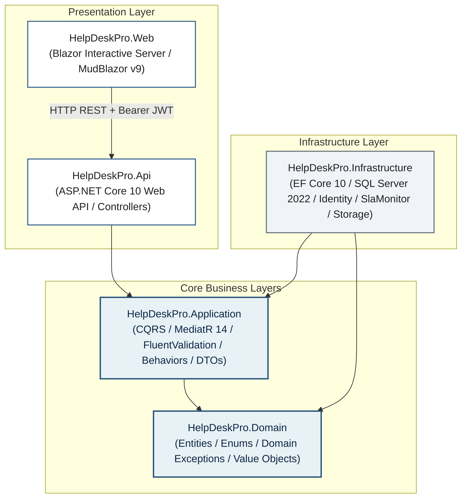
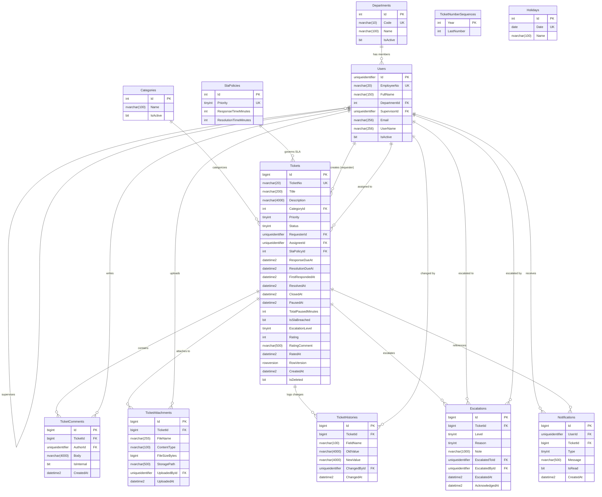
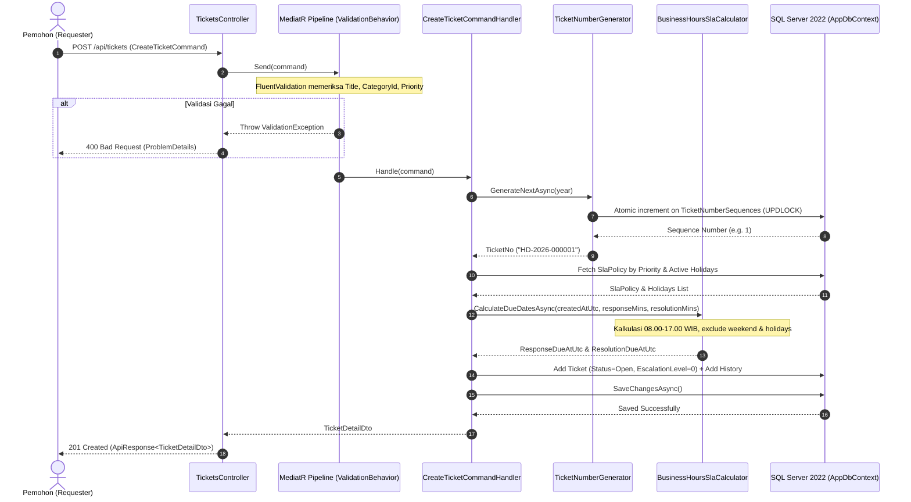
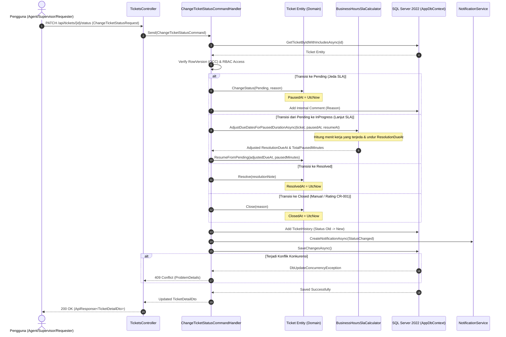
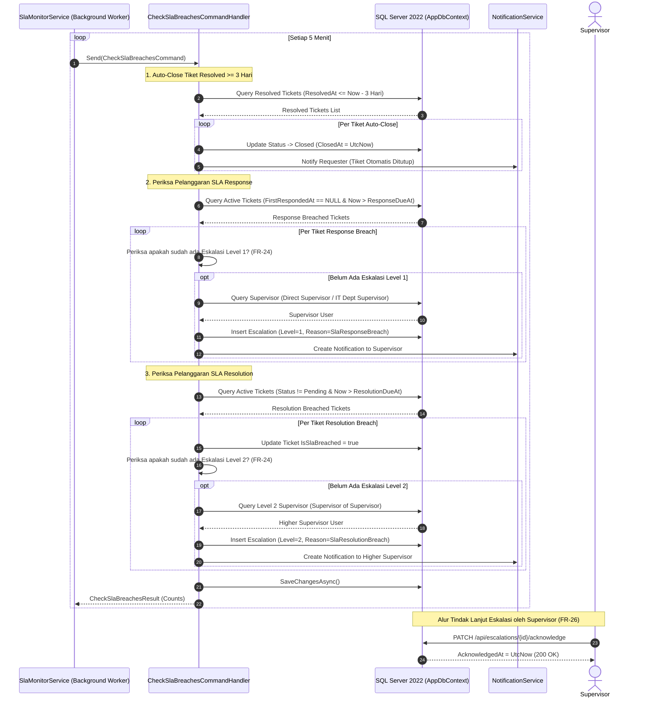

# Technical Specification Document (TSD) — HelpDeskPro

---

## 1. Document Control

### 1.1 Informasi Dokumen
| Atribut | Nilai |
|---|---|
| **Nama Proyek** | HelpDeskPro — Enterprise Internal IT Helpdesk & Ticketing System |
| **Kode Dokumen** | HDP-TSD-001 |
| **Versi Dokumen** | 1.1.0 |
| **Tanggal Pembaruan** | 11 November 2026 |
| **Status Dokumen** | Approved (Final Technical Baseline) |
| **Klasifikasi Akses** | Internal Enterprise Restricted |
| **Penulis (Author)** | Lead Systems Architect / Core Engineering Team |
| **Peninjau (Reviewer)** | Technical Lead & Lead QA Engineer |

### 1.2 Riwayat Revisi
| Versi | Tanggal | Penulis | Deskripsi Perubahan |
|:---:|:---:|---|---|
| **1.0.0** | 10 November 2026 | Engineering Team | Rilis baseline teknis v1.0.0: Implementasi modul inti Clean Architecture, autentikasi JWT, alur tiket, SLA dasar, background monitor, dan Blazor UI. |
| **1.0.1** | 10 November 2026 | Engineering Team | Penambahan CR-001: Fitur rating kepuasan layanan 1–5 bintang, auto-closing tiket resolved, dan metrik kepuasan pada dashboard supervisor. |
| **1.0.2** | 10 November 2026 | Engineering Team | Penambahan CR-002: Perhitungan SLA berbasis jam kerja (08.00–17.00 WIB), master data hari libur nasional (`Holidays`), dan penetapan ADR-002. |
| **1.1.0** | 11 November 2026 | Engineering Team | Penambahan CR-003: Modernisasi platform menyeluruh dari .NET 8 ke **.NET 10 (LTS)**, integrasi MudBlazor v9, OpenAPI 2.0 / Swashbuckle 10, dan C# 14 analyzer hardening. |

---

## 2. Pendahuluan, Ruang Lingkup, dan Referensi

### 2.1 Pendahuluan & Latar Belakang Teknis
HelpDeskPro adalah sistem helpdesk terpadu berskala *enterprise* yang dirancang untuk menggantikan komunikasi penanganan insiden/permintaan layanan IT yang sebelumnya tersebar secara tidak terstruktur melalui email dan aplikasi percakapan instan. Sistem menjamin kepatuhan *Service Level Agreement* (SLA) melalui pelacakan durasi real-time, eskalasi otomatis berjenjang ke supervisor, pelacakan riwayat perubahan (*audit trail*) transparan, serta keamanan tingkat tinggi berbasis peran pengguna (*Role-Based Access Control*).

### 2.2 Ruang Lingkup Sistem
Ruang lingkup arsitektur dan sistem HelpDeskPro mencakup:
1. **Layanan Back-End API (`HelpDeskPro.Api`)**: Antarmuka RESTful API berbasis ASP.NET Core 10 Web API yang mengekspos endpoint autentikasi, transaksi tiket, kalkulasi SLA jam kerja, eskalasi otomatis, analitik dashboard, dan administrasi master data.
2. **Lapisan Logika Bisnis & Domain (`HelpDeskPro.Application` & `HelpDeskPro.Domain`)**: Inti logika bisnis berbasis *Clean Architecture* dan *Domain-Driven Design* (DDD) yang terisolasi dari framework eksternal, mengimplementasikan *Command Query Responsibility Segregation* (CQRS) dengan MediatR.
3. **Lapisan Infrastruktur & Data (`HelpDeskPro.Infrastructure`)**: Implementasi akses database Microsoft SQL Server 2022 via Entity Framework Core 10, penyimpanan berkas lokal terisolasi, layanan token JWT, background worker pemantau SLA, dan kalender jam kerja Indonesia (WIB).
4. **Antarmuka Front-End (`HelpDeskPro.Web`)**: Web app berbasis Blazor Interactive Server (.NET 10) dengan pustaka komponen UI MudBlazor v9 yang dirancang mematuhi standar desain ergonomis (kepadatan tinggi, font IBM Plex Sans, tanpa kartu statistik besar yang membuang ruang layar).

### 2.3 Referensi Dokumen
- [docs/FSD-HelpDeskPro.md](file:///c:/Users/Akhmad%20Rizaldy/.gemini/antigravity-ide/scratch/HelpDeskPro-Antigravity/HelpDeskPro-Antigravity/docs/FSD-HelpDeskPro.md): *Functional Specification Document* v1.0.
- [docs/CR/CR-001.md](file:///c:/Users/Akhmad%20Rizaldy/.gemini/antigravity-ide/scratch/HelpDeskPro-Antigravity/HelpDeskPro-Antigravity/docs/CR/CR-001.md): *Change Request 001 — Service Satisfaction Rating*.
- [docs/CR/CR-002.md](file:///c:/Users/Akhmad%20Rizaldy/.gemini/antigravity-ide/scratch/HelpDeskPro-Antigravity/HelpDeskPro-Antigravity/docs/CR/CR-002.md): *Change Request 002 — Business Hours SLA Calculation*.
- [docs/CR/CR-003.md](file:///c:/Users/Akhmad%20Rizaldy/.gemini/antigravity-ide/scratch/HelpDeskPro-Antigravity/HelpDeskPro-Antigravity/docs/CR/CR-003.md): *Change Request 003 — .NET 10 LTS Platform Upgrade*.
- [docs/ADR/002-business-hours-sla.md](file:///c:/Users/Akhmad%20Rizaldy/.gemini/antigravity-ide/scratch/HelpDeskPro-Antigravity/HelpDeskPro-Antigravity/docs/ADR/002-business-hours-sla.md): *Architectural Decision Record 002*.
- [docs/database/data-dictionary.md](file:///c:/Users/Akhmad%20Rizaldy/.gemini/antigravity-ide/scratch/HelpDeskPro-Antigravity/HelpDeskPro-Antigravity/docs/database/data-dictionary.md): Kamus Data Skema Basis Data SQL Server.
- `.agent/rules/coding-standard.md` & `.agent/rules/ui-design.md`: Pedoman rekayasa perangkat lunak dan desain UI.

---

## 3. Arsitektur Sistem

### 3.1 Diagram Arsitektur Lapisan (Layer Diagram)
HelpDeskPro mengadopsi pola **Clean Architecture (Onion Architecture)** dengan pemisahan dependensi satu arah ke arah dalam (*Inversion of Dependency Principle*).



### 3.2 Alasan Pemilihan Clean Architecture & Pola Desain
1. **Kemandirian Logika Bisnis (*Independent of Frameworks*)**:
   - `HelpDeskPro.Domain` tidak memiliki dependensi terhadap pustaka eksternal pihak ketiga mana pun. Entitas (`Ticket`, `User`, `Holiday`, dll.) memuat metode enkapsulasi domain mutlak (`ticket.ChangeStatus()`, `ticket.SetRating()`, `ticket.Resolve()`).
2. **Penerapan Pola CQRS (*Command Query Responsibility Segregation*)**:
   - Memisahkan secara tegas antara mutasi data (Commands) dan pembacaan data (Queries) menggunakan **MediatR 14**. Setiap operasi bisnis memiliki handler tunggal yang berfokus (*Single Responsibility Principle*).
3. **Pipeline Behaviors Lintas Modul (*Cross-Cutting Concerns*)**:
   - **`ValidationBehavior`**: Mencegat seluruh command dan query untuk validasi input otomatis via **FluentValidation** sebelum masuk ke handler.
   - **`LoggingBehavior`**: Mengukur waktu eksekusi request dan mencatat log terstruktur secara otomatis.
4. **Sentralisasi Akses Data melalui Abstraksi**:
   - Layer aplikasi hanya bergantung pada antarmuka `IApplicationDbContext`, `IDateTimeProvider`, `ISlaCalculator`, dan `INotificationService`, sehingga memudahkan *unit testing* menggunakan *mocking* tanpa perlu koneksi database riil.

### 3.3 Daftar Keputusan Arsitektur (*Architectural Decision Records / ADR*)
| ID ADR | Judul Keputusan | Status | Inti Keputusan & Implikasi |
|:---:|---|:---:|---|
| **ADR-001** | Pemisahan Proyek Clean Architecture & Central Package Management (CPM) | Diterima | Memisahkan solusi menjadi 5 proyek produksi dan 2 proyek pengujian. Versi seluruh paket NuGet dikelola terpusat pada `Directory.Packages.props`. |
| **ADR-002** | Perhitungan SLA Jam Kerja & Kebijakan Immutability Tiket Eksisting | Diterima | Perhitungan SLA jam kerja (08.00–17.00 WIB Senin–Jumat) dan hari libur hanya berlaku untuk tiket baru; **tiket eksisting tidak dihitung ulang** guna menjaga integritas audit historis. |
| **ADR-003** | Modernisasi Solusi ke Runtime .NET 10 LTS | Diterima | Peningkatan platform ke .NET 10 LTS untuk mendapatkan performa runtime maksimal, adopsi OpenAPI 2.0, dan MudBlazor v9 dengan tetap mempertahankan kompatibilitas `FluentValidation 12.2.0` (Opsi A). |

---

## 4. Desain Basis Data

### 4.1 Entity-Relationship Diagram (ERD)
Database HelpDeskPro dibangun di atas **Microsoft SQL Server 2022** dengan 12 tabel yang ternormalisasi secara ketat.



### 4.2 Ringkasan Entitas & Konfigurasi Khusus
1. **`Tickets`**:
   - **Optimistic Concurrency**: Kolom `RowVersion` bertipe `rowversion` / `byte[]` dengan pemetaan EF Core `.IsRowVersion()`. Jika dua proses mengedit tiket bersamaan, sistem mendeteksi konflik dan mengembalikan HTTP 409 Conflict.
   - **Soft Delete**: Global Query Filter `e.IsDeleted == false`.
   - **Filtered Index Kinerja**:
     - `IX_Tickets_ResolutionDueAt` pada status aktif (`WHERE Status IN (1, 2, 3)`).
     - `IX_Tickets_Status_Priority` dan `IX_Tickets_AssigneeId_Status`.
2. **`Escalations`**:
   - **Unique Filtered Index**: `CREATE UNIQUE INDEX IX_Escalations_TicketId_Level_Reason ON Escalations (TicketId, Level, Reason) WHERE Reason <> 3`. Mencegah duplikasi eskalasi sistemik otomatis (Level 1 SLA Response Breach atau Level 2 SLA Resolution Breach) untuk tiket yang sama (FR-24).
3. **`TicketNumberSequences`**:
   - Digunakan untuk penerbitan nomor urut tiket bebas *race-condition*.
4. **`Holidays`**:
   - Kolom `Date` bertipe `date` memiliki unique index `IX_Holidays_Date`.
5. **Kamus Data Lengkap**: Rincian definisi tipe kolom, indeks, default value, dan konstrain foreign key dapat diakses di [docs/database/data-dictionary.md](file:///c:/Users/Akhmad%20Rizaldy/.gemini/antigravity-ide/scratch/HelpDeskPro-Antigravity/HelpDeskPro-Antigravity/docs/database/data-dictionary.md).

---

## 5. Desain API

### 5.1 Format Standar Respons Sukses (`ApiResponse<T>`)
Seluruh respons sukses dari endpoint REST API HelpDeskPro dibungkus dalam format seragam:
```json
{
  "success": true,
  "data": { ... },
  "errors": [],
  "traceId": "00-4bf92f3577b34da6a3ce929d0e0e4736-00f067aa0ba902b7-01"
}
```

### 5.2 Format Standar Kesalahan (*RFC 7807 ProblemDetails*)
Ketika terjadi kesalahan validasi atau exception bisnis, API mengembalikan payload berstandar *RFC 7807 / RFC 9457* dengan Content-Type `application/problem+json`:

```json
{
  "type": "https://tools.ietf.org/html/rfc7231#section-6.5.1",
  "title": "Terjadi kesalahan validasi.",
  "status": 400,
  "detail": "Satu atau lebih kesalahan validasi terjadi pada data yang dikirimkan.",
  "instance": "/api/tickets",
  "errors": {
    "Title": ["Judul tiket wajib diisi antara 5 hingga 200 karakter."]
  },
  "traceId": "00-4bf92f3577b34da6a3ce929d0e0e4736-00f067aa0ba902b7-01"
}
```

### 5.3 Pemetaan Status Kode HTTP Global Exception Middleware
| Jenis Exception | HTTP Status Code | Judul ProblemDetails | Keterangan |
|---|:---:|---|---|
| `ValidationException` | `400 Bad Request` | Terjadi kesalahan validasi. | Kegagalan aturan validasi FluentValidation. |
| `ForbiddenAccessException` / `UnauthorizedAccessException` | `403 Forbidden` | Akses ditolak. | User tidak memiliki izin atas resource terkait. |
| `NotFoundException` / `KeyNotFoundException` | `404 Not Found` | Data tidak ditemukan. | Entitas (tiket, user, file) tidak ditemukan. |
| `DbUpdateConcurrencyException` | `409 Conflict` | Konflik pembaruan data. | Tiket telah diubah pengguna lain secara bersamaan. |
| `BusinessRuleException` | `422 Unprocessable Entity` | Pelanggaran aturan bisnis. | Pelanggaran alur status atau batasan domain. |
| `Exception` (Unhandled) | `500 Internal Server Error` | Terjadi kesalahan pada server. | Kesalahan sistem tak terduga (di-log detail ke Serilog). |

---

### 5.4 Matriks Endpoint RESTful API

#### A. Autentikasi (`/api/auth`)
| Method | Path | Otorisasi / Role | Request Payload | Response Body (Data) | Error Codes |
|:---:|---|---|---|---|:---:|
| `POST` | `/api/auth/login` | Anonymous | `LoginCommand` `{ email, password }` | `AuthResponseDto` `{ token, user }` | 400, 422 |
| `GET` | `/api/auth/me` | `[Authorize]` | None | `UserDto` | 401 |

#### B. Tiket (`/api/tickets`)
| Method | Path | Otorisasi / Role | Request Payload / Query | Response Body (Data) | Error Codes |
|:---:|---|---|---|---|:---:|
| `GET` | `/api/tickets` | `[Authorize]` | Query: `GetTicketsQuery` | `PagedResult<TicketListItemDto>` | 401 |
| `GET` | `/api/tickets/filter-options` | `[Authorize]` | None | `TicketFilterOptionsDto` | 401 |
| `GET` | `/api/tickets/{id}` | `[Authorize]` | Route: `id` (long) | `TicketDetailDto` | 401, 404 |
| `POST` | `/api/tickets` | `[Authorize]` | `CreateTicketCommand` | `TicketDetailDto` (HTTP 201) | 400, 401, 404 |
| `PUT` | `/api/tickets/{id}` | `[Authorize]` | `UpdateTicketRequest` | `TicketDetailDto` | 400, 401, 403, 404, 409, 422 |
| `PATCH` | `/api/tickets/{id}/assign` | `[Authorize]` | `AssignTicketRequest` `{ assigneeId, rowVersion }` | `TicketDetailDto` | 400, 401, 403, 404, 409, 422 |
| `PATCH` | `/api/tickets/{id}/status` | `[Authorize]` | `ChangeTicketStatusRequest` `{ status, reason, rowVersion }` | `TicketDetailDto` | 400, 401, 403, 404, 409, 422 |
| `POST` | `/api/tickets/{id}/comments` | `[Authorize]` | `AddCommentRequest` `{ body, isInternal }` | `TicketCommentDto` (HTTP 201) | 400, 401, 403, 404, 422 |
| `POST` | `/api/tickets/{id}/attachments`| `[Authorize]` | `multipart/form-data` (`file`) | `TicketAttachmentDto` (HTTP 201) | 400, 401, 403, 404, 422 |
| `GET` | `/api/tickets/{id}/attachments/{attachmentId}` | `[Authorize]` | Route: `id`, `attachmentId` | `FileStreamResult` (Binary) | 401, 404 |
| `GET` | `/api/tickets/{id}/history` | `[Authorize]` | Route: `id` (long) | `IReadOnlyList<TicketHistoryDto>` | 401, 404 |
| `POST` | `/api/tickets/{id}/escalate`| `[Authorize]` | `EscalateTicketRequest` `{ note }` | `EscalationDto` | 400, 401, 403, 404, 422 |
| `POST` | `/api/tickets/{id}/rate` | `RequireRequesterOrAdmin`| `RateTicketRequest` `{ rating, comment }` | `TicketDetailDto` | 400, 401, 403, 404, 422 |

#### C. Dashboard & Eskalasi (`/api/dashboard` & `/api/escalations`)
| Method | Path | Otorisasi / Role | Request Payload / Query | Response Body (Data) | Error Codes |
|:---:|---|---|---|---|:---:|
| `GET` | `/api/dashboard/summary` | `RequireSupervisorOrAbove` | Query: `periodDays` (default 30) | `DashboardSummaryDto` | 401, 403 |
| `GET` | `/api/dashboard/agent-workload` | `RequireSupervisorOrAbove` | Query: `days` (nullable) | `IReadOnlyList<AgentWorkloadDto>` | 401, 403 |
| `GET` | `/api/dashboard/pending-escalations`| `RequireSupervisorOrAbove`| None | `IReadOnlyList<PendingEscalationDto>` | 401, 403 |
| `PATCH` | `/api/escalations/{id}/acknowledge` | `[Authorize]` | Route: `id` (long) | `EscalationDto` | 400, 401, 404, 422 |

#### D. Notifikasi (`/api/notifications`)
| Method | Path | Otorisasi / Role | Request Payload | Response Body (Data) | Error Codes |
|:---:|---|---|---|---|:---:|
| `GET` | `/api/notifications` | `[Authorize]` | None | `IReadOnlyList<NotificationDto>` | 401 |
| `GET` | `/api/notifications/unread-count` | `[Authorize]` | None | `int` | 401 |
| `PATCH`| `/api/notifications/read-all` | `[Authorize]` | None | `int` (jumlah dibaca) | 401 |

#### E. Master Data (`/api/master/*`) — Policy: `RequireAdmin`
| Method | Path | Resource | Request Payload / Query | Response Body (Data) | Error Codes |
|:---:|---|---|---|---|:---:|
| `GET` | `/api/master/departments` | Departemen | Query: `isActive` | `IReadOnlyList<DepartmentDto>` | 401, 403 |
| `POST` | `/api/master/departments` | Departemen | `CreateDepartmentCommand` | `DepartmentDto` (HTTP 201) | 400, 401, 403, 422 |
| `PUT` | `/api/master/departments/{id}` | Departemen | `UpdateDepartmentCommand` | `DepartmentDto` | 400, 401, 403, 404, 422 |
| `PATCH`| `/api/master/departments/{id}/toggle-status`| Departemen | None | `DepartmentDto` | 401, 403, 404 |
| `DELETE`| `/api/master/departments/{id}` | Departemen | None | `string` | 401, 403, 404, 422 |
| `GET` | `/api/master/categories` | Kategori | Query: `isActive` | `IReadOnlyList<CategoryDto>` | 401, 403 |
| `POST` | `/api/master/categories` | Kategori | `CreateCategoryCommand` | `CategoryDto` (HTTP 201) | 400, 401, 403, 422 |
| `PUT` | `/api/master/categories/{id}` | Kategori | `UpdateCategoryCommand` | `CategoryDto` | 400, 401, 403, 404, 422 |
| `PATCH`| `/api/master/categories/{id}/toggle-status`| Kategori | None | `CategoryDto` | 401, 403, 404 |
| `DELETE`| `/api/master/categories/{id}` | Kategori | None | `string` | 401, 403, 404, 422 |
| `GET` | `/api/master/sla-policies` | SLA Policy | None | `IReadOnlyList<SlaPolicyDto>` | 401, 403 |
| `PUT` | `/api/master/sla-policies/{priority}` | SLA Policy | `UpdateSlaPolicyRequest` | `SlaPolicyDto` | 400, 401, 403, 404 |
| `GET` | `/api/master/holidays` | Hari Libur (CR-002) | Query: `year` | `IReadOnlyList<HolidayDto>` | 401, 403 |
| `POST` | `/api/master/holidays` | Hari Libur (CR-002) | `CreateHolidayCommand` `{ date, name }` | `HolidayDto` (HTTP 200) | 400, 401, 403, 422 |
| `PUT` | `/api/master/holidays/{id}` | Hari Libur (CR-002) | `UpdateHolidayCommand` `{ id, date, name }` | `HolidayDto` | 400, 401, 403, 404, 422 |
| `DELETE`| `/api/master/holidays/{id}` | Hari Libur (CR-002) | None | `string` | 401, 403, 404 |
| `GET` | `/api/master/users` | Pengguna | Query: `GetUsersQuery` | `PagedResult<UserListItemDto>` | 401, 403 |
| `GET` | `/api/master/users/{id}` | Pengguna | Route: `id` (Guid) | `UserDetailDto` | 401, 403, 404 |
| `POST` | `/api/master/users` | Pengguna | `CreateUserCommand` | `UserDetailDto` (HTTP 201) | 400, 401, 403, 422 |
| `PUT` | `/api/master/users/{id}` | Pengguna | `UpdateUserCommand` | `UserDetailDto` | 400, 401, 403, 404, 422 |
| `PATCH`| `/api/master/users/{id}/toggle-status` | Pengguna | Query: `isActive` | `UserDetailDto` | 401, 403, 404, 422 |
| `POST` | `/api/master/users/{id}/reset-password`| Pengguna | `ResetPasswordRequest` | `string` | 400, 401, 403, 404 |
| `DELETE`| `/api/master/users/{id}` | Pengguna | None | `string` | 401, 403, 404, 422 |

---

## 6. Desain Modul Utama

### 6.1 Modul 1: Pembuatan Tiket (*Create Ticket*)
- **Referensi Kebutuhan**: FR-03, FR-04, FR-05, FR-06, CR-002.
- **Aturan Bisnis (Business Rules)**:
  1. Judul wajib diisi 5–200 karakter; Deskripsi opsional maks 4000 karakter.
  2. Kategori wajib ada dan berstatus aktif (`IsActive == true`).
  3. Nomor urut tiket (`TicketNo`) berformat `HD-{YYYY}-{6 digit urut}` diterbitkan melalui lock transaksi database (`TicketNumberSequences`) untuk mencegah duplikasi pada kondisi konkurensi tinggi.
  4. Batas waktu SLA (`ResponseDueAt` dan `ResolutionDueAt`) dihitung menggunakan **`ISlaCalculator` (`BusinessHoursSlaCalculator`)**: hanya jam kerja 08.00–17.00 WIB Senin–Jumat yang dihitung. Tiket yang dibuat di luar jam kerja mulai dihitung pada pukul 08.00 WIB hari kerja berikutnya.
  5. Status tiket awal adalah `Open`.
  6. Entri audit awal otomatis dicatat pada `TicketHistories` dengan keterangan `"Tiket dibuat"`.



---

### 6.2 Modul 2: Perubahan Status Tiket (*Ticket Status Transition*)
- **Referensi Kebutuhan**: FR-10, FR-11, FR-12, FR-13, FR-14, FR-15, FR-16, FR-17, FR-19, FR-27, CR-001.
- **Diagram Status & Aturan Transisi**:
  ```
  Open ──► InProgress ◄──► Pending
    │           │
    │           ▼
    │       Resolved ──► Closed
    │           │
    │           └──► InProgress (Reopen maks 7 hari)
    ▼
  Cancelled
  ```
- **Aturan Bisnis (Business Rules)**:
  1. **Hak Akses Status**:
     - `Requester`: Hanya dapat membatalkan tiket (`Cancelled`) saat status `Open`, atau menutup tiket (`Closed`) saat status `Resolved`.
     - `Agent`: Mengelola siklus kerja tiket (`InProgress`, `Pending`, `Resolved`).
     - `Supervisor` & `Admin`: Memiliki hak penuh atas seluruh status yang sah.
  2. **Transisi Tidak Sah**: Transisi di luar diagram domain dilempar sebagai `BusinessRuleException` dengan pesan *"Perubahan status dari {A} ke {B} tidak diizinkan."* (HTTP 422).
  3. **Pending & SLA Pause (FR-13, FR-27)**: Transisi ke `Pending` wajib menyertakan alasan (disimpan sebagai komentar internal) dan mengisi `PausedAt`. Saat kembali dari `Pending` ke `InProgress`, durasi jeda dihitung dalam jam kerja aktif dan `ResolutionDueAt` otomatis diundur sejumlah menit kerja yang terlewat (`AdjustDueDatesForPausedDurationAsync`).
  4. **Resolusi (FR-14)**: Transisi ke `Resolved` wajib menyertakan catatan penyelesaian dan mencatat stempel waktu `ResolvedAt`.
  5. **Reopen (FR-16)**: Tiket `Resolved` hanya dapat dibuka kembali maksimal 7 hari sejak `ResolvedAt`.
  6. **Rating Kepuasan (CR-001)**: Pemohon tiket dapat mengirimkan rating (1–5) saat status `Resolved`. Pengiriman rating berhasil secara atomik mengubah status tiket dari `Resolved` menjadi `Closed`.
  7. **Konkurensi Optimistik (FR-17)**: Wajib menyertakan token `RowVersion`.



---

### 6.3 Modul 3: SLA Monitor & Eskalasi Otomatis
- **Referensi Kebutuhan**: FR-15, FR-21, FR-22, FR-23, FR-24, FR-25, FR-26.
- **Aturan Bisnis (Business Rules)**:
  1. **Background Service (`SlaMonitorService`)**: Dijalankan secara periodik setiap 5 menit (dikonfigurasi via `SlaMonitor:IntervalMinutes`).
  2. **Auto-Closing 3 Hari (FR-15)**: Tiket berstatus `Resolved` dengan `ResolvedAt <= UtcNow - 3 days` otomatis ditutup permanen (`Closed`) oleh sistem dengan notifikasi ke requester.
  3. **Eskalasi Level 1 (SLA Response Breach, FR-22)**:
     - Kondisi: Tiket aktif (`Open`, `InProgress`), `FirstRespondedAt == null`, dan `UtcNow > ResponseDueAt`.
     - Target Eskalasi: Supervisor langsung dari Agent penangan. Jika tiket belum di-assign, eskalasi diarahkan ke Supervisor Departemen IT.
     - Penerima menerima notifikasi in-app tipe `Escalation`.
  4. **Eskalasi Level 2 (SLA Resolution Breach, FR-23)**:
     - Kondisi: Tiket aktif bukan `Pending`, dan `UtcNow > ResolutionDueAt`.
     - Sistem menandai properti `IsSlaBreached = true`.
     - Target Eskalasi: Atasan dari Supervisor (`Supervisor.SupervisorId`).
  5. **Idempotensi Eskalasi (FR-24)**: Eskalasi otomatis dengan level dan alasan yang sama untuk satu tiket hanya diterbitkan tepat satu kali (dijamin melalui pengecekan relasi dan database filtered unique index `IX_Escalations_TicketId_Level_Reason`).
  6. **Eskalasi Manual (FR-25)**: Agent atau Supervisor dapat memicu eskalasi manual dengan menyertakan catatan minimal 10 karakter.
  7. **Konfirmasi Tindak Lanjut (FR-26)**: Supervisor penerima eskalasi menandai tiket telah ditindaklanjuti melalui tombol "Tindaklanjuti", yang mencatat `AcknowledgedAt = UtcNow`.



---

## 7. Keamanan Sistem (*Security Architecture*)

### 7.1 Autentikasi Pengguna
1. **Penerbitan Token JWT**: Menggunakan standar algoritma *HMAC-SHA256* dengan rahasia simetris minimal 256-bit (`JwtSettings:SecretKey`). Token memuat klaim standar: `sub` (User ID), `email`, `name`, `role`, dan `departmentName` dengan masa berlaku 8 jam.
2. **Penguncian Akun (*Account Lockout*)**: Dikonfigurasi melalui ASP.NET Core Identity. Jika pengguna gagal memasukkan password sebanyak 5 kali berturut-turut (`MaxFailedAccessAttempts = 5`), akun otomatis terkunci selama 15 menit (`DefaultLockoutTimeSpan = 15m`).
3. **Hashing Password**: Menggunakan algoritma *PBKDF2 dengan HMAC-SHA512* standar ASP.NET Core Identity (work factor aman tanpa penyimpanan teks terbuka).

### 7.2 Matriks Otorisasi Berbasis Peran & Akses Baris Data (Row-Level Security)
| Fitur / Aksi | Requester | Agent | Supervisor | Admin | Penegakan Kebijakan (*Enforcement*) |
|---|:---:|:---:|:---:|:---:|---|
| **Login & Profil Diri** | Ya | Ya | Ya | Ya | `[Authorize]` |
| **Buat Tiket Baru** | Ya | Ya | Ya | Ya | `[Authorize]` |
| **Lihat Daftar Tiket** | Milik Sendiri | Di-assign + Unassigned Pool | Semua tiket di departemennya | Semua Tiket | Filter EF Core pada `GetTicketsQueryHandler` |
| **Lihat Detail Tiket** | Milik Sendiri | Di-assign + Unassigned Pool | Semua tiket di departemennya | Semua Tiket | Pengecekan ID pengguna pada `GetTicketByIdQueryHandler` |
| **Komentar Publik** | Ya | Ya | Ya | Ya | `[Authorize]` |
| **Komentar Internal** | **Tidak (Tersembunyi)** | Ya | Ya | Ya | Dikecualikan dari DTO jika role pemohon = `Requester` |
| **Ubah Status Tiket** | Batal (Open), Tutup (Resolved) | Ya | Ya | Ya | Aturan domain pada `ChangeTicketStatusCommandHandler` |
| **Ambil Mandiri (*Self-Assign*)** | Tidak | Ya | Ya | Ya | Validasi `AssigneeId == CurrentUserId` |
| **Tugaskan Tiket ke Agent Lain** | Tidak | Tidak | Ya | Ya | `RequireSupervisorOrAbove` |
| **Eskalasi Manual** | Tidak | Ya | Ya | Ya | `RequireAgentOrAbove` |
| **Tindak Lanjut Eskalasi** | Tidak | Tidak | Ya (Penerima) | Ya | Verifikasi `EscalatedToId == CurrentUserId` |
| **Beri Rating Kepuasan** | Ya (Pemilik) | Tidak | Tidak | Ya | Role `Requester,Admin` pada `RateTicketCommandHandler` |
| **Akses Dashboard & Laporan** | Tidak | Tidak | Ya | Ya | Policy `RequireSupervisorOrAbove` |
| **Kelola Master Data & User** | Tidak | Tidak | Tidak | Ya | Policy `RequireAdmin` |

### 7.3 Penanganan Unggah Berkas Lampiran (*Secure File Upload*)
1. **Whitelist Ekstensi Ketat**: Hanya menerima ekstensi `.jpg`, `.jpeg`, `.png`, `.pdf`, `.docx`, `.xlsx`, `.txt`, `.log`.
2. **Pemeriksaan Batas Ukuran**: File dibatasi maksimal 5 MB (5.242.880 bytes).
3. **Batas Jumlah Berkas**: Maksimal 5 lampiran untuk satu tiket.
4. **Isolasi Penyimpanan Fisik (`LocalFileStorage`)**: Berkas tidak disimpan di dalam direktori publik web (`wwwroot`). Berkas disimpan menggunakan nama unik berbasis GUID (`{guid}{extension}`) di direktori penyimpanan khusus (`Uploads/attachments/`), mencegah eksploitasi *Path Traversal* (`../`) dan eksekusi skrip berbahaya di sisi server.
5. **Akses Unduh Terotorisasi**: File hanya dapat diunduh melalui endpoint `/api/tickets/{id}/attachments/{attachmentId}` setelah melewati verifikasi hak akses tiket.

### 7.4 Manajemen Rahasia (*Secret Management*)
- Kunci enkripsi (`JwtSettings:SecretKey`), kredensial koneksi database (`ConnectionStrings:DefaultConnection`), dan password seed awal **tidak disimpan di dalam repositori source code**.
- Lingkungan produksi menyuntikkan nilai sensitif ini melalui *Environment Variables* OS / container (`ConnectionStrings__DefaultConnection`, `JwtSettings__SecretKey`).

---

## 8. Logging, Monitoring, dan Penanganan Kesalahan

### 8.1 Logging Terstruktur (*Structured Logging*)
Aplikasi menggunakan **Serilog** dengan konfigurasi:
- **Sinks**: Console (output kontainer) dan Rolling Daily File (`logs/helpdeskpro-.txt`, retensi 31 hari).
- **Template Log**:
  `{Timestamp:yyyy-MM-dd HH:mm:ss.fff zzz} [{Level:u3}] [{TraceId}] {Message:lj}{NewLine}{Exception}`
- **Correlation & Trace ID**: Setiap request HTTP mendapatkan TraceId unik (`Activity.Current?.Id ?? HttpContext.TraceIdentifier`) yang otomatis disisipkan pada setiap baris log, respons header, `ApiResponse`, dan `ProblemDetails`.

### 8.2 Audit Log Otomatis (*Auditable Entities & Interceptors*)
Setiap entitas yang mewarisi `AuditableEntity` (`Tickets`, `Departments`, dll.) secara otomatis diisi nilai auditnya oleh **`AuditableEntityInterceptor`** pada event EF Core `SavingChangesAsync`:
- `CreatedAt` dan `CreatedBy` (saat entitas berstatus `Added`).
- `UpdatedAt` dan `UpdatedBy` (saat entitas berstatus `Modified`).
- Waktu dicatat dalam standar presisi tinggi **UTC**.

---

## 9. Strategi Pengujian & Matriks Test Case

### 9.1 Piramida & Metodologi Pengujian
1. **Unit Testing (`HelpDeskPro.UnitTests`)**:
   - Menargetkan pengujian unit terisolasi pada layer Application dan Domain.
   - Pustaka: **xUnit 2.9.3**, **FluentAssertions 8.11.0**, dan **NSubstitute 6.2.0**.
   - Menghasilkan 339 pengujian unit yang mencakup seluruh validator, handler CQRS, mesin status domain, dan kalkulator jam kerja SLA.
2. **Integration Testing (`HelpDeskPro.IntegrationTests`)**:
   - Menggunakan **`WebApplicationFactory<Program>`** untuk menguji end-to-end API HTTP Controller, middleware, autentikasi JWT, otorisasi role, dan interaksi database.
   - Menghasilkan 37 pengujian integrasi komprehensif.
3. **Cakupan Pengujian (*Code Coverage*)**:
   - Coverage layer Application: **83,5%** (melampaui target NFR-05 $\ge 70\%$).
   - Coverage layer Domain: **90,9%**.

### 9.2 Matriks Kasus Uji Lengkap (*Test Cases Matrix*)

| ID Test | Kebutuhan Terkait | Skenario Pengujian | Langkah Pengujian | Hasil yang Diharapkan | Status |
|:---:|:---:|---|---|---|:---:|
| **TC-AC-01** | FR-03, FR-05, AC-01 | Pembuatan tiket prioritas High | Kirim `CreateTicketCommand` (Priority: High) pada hari kerja jam 09.00 WIB | Tiket terbentuk, status Open, ResponseDueAt = +2 jam kerja (11.00 WIB) | **LULUS** |
| **TC-AC-02** | FR-04, AC-02 | Konkurensi pembuatan tiket simultan | Jalankan request pembuatan tiket paralel pada waktu bersamaan | Diterbitkan TicketNo unik berurutan tanpa duplikasi urutan | **LULUS** |
| **TC-AC-03** | FR-12, AC-03 | Transisi ilegal Open langsung ke Resolved | Agent mengirim request ganti status Open → Resolved | Ditolak HTTP 422 ("Perubahan status dari Open ke Resolved tidak diizinkan") | **LULUS** |
| **TC-AC-04** | FR-22, AC-04 | Eskalasi Level 1 saat respons SLA terlampaui | Jalankan check SLA pada tiket Critical tanpa respons setelah batas waktu | Eskalasi Level 1 terbentuk tepat satu kali, notifikasi terkirim ke Supervisor | **LULUS** |
| **TC-AC-05** | FR-16, AC-05 | Isolasi komentar internal bagi Requester | Requester membuka tiket yang memiliki komentar internal agen | Komentar bertanda `IsInternal=true` disaring dan tidak muncul di response | **LULUS** |
| **TC-AC-06** | FR-18, AC-06 | Validasi tipe file berbahaya (.exe) | Unggah lampiran berkas berekstensi `.exe` | Ditolak HTTP 400 dengan pesan kesalahan "Tipe file tidak diizinkan" | **LULUS** |
| **TC-AC-07** | FR-27, AC-07 | Pergeseran jatuh tempo saat jeda Pending | Tiket berstatus Pending selama 2 jam kerja lalu kembali InProgress | `ResolutionDueAt` otomatis digeser mundur persis 120 menit kerja | **LULUS** |
| **TC-CR-01A**| CR-001 | Pemberian rating kepuasan pada tiket Resolved | Requester mengirim rating 5 dan komentar pada tiket miliknya berstatus Resolved | Rating tersimpan, tiket otomatis berubah status menjadi Closed | **LULUS** |
| **TC-CR-01B**| CR-001 | Pencegahan rating ganda | Kirim rating kedua kalinya pada tiket yang sudah memiliki rating | Ditolak HTTP 422 ("Tiket ini sudah diberi rating sebelumnya") | **LULUS** |
| **TC-CR-01C**| CR-001 | Pencegahan rating oleh non-pemilik | Agent mencoba memberi rating pada tiket orang lain | Ditolak HTTP 403 Forbidden | **LULUS** |
| **TC-CR-02A**| CR-002 | Tiket dibuat sebelum jam kerja (07.00 WIB) | Buat tiket jam 07.00 WIB pada hari kerja (SLA 4 jam kerja) | Waktu mulai dihitung dari 08.00 WIB; jatuh tempo pukul 12.00 WIB hari yang sama | **LULUS** |
| **TC-CR-02B**| CR-002 | Tiket dibuat setelah jam kerja (18.00 WIB) | Buat tiket jam 18.00 WIB pada hari Senin (SLA 4 jam kerja) | Waktu mulai dihitung pukul 08.00 WIB hari Selasa; jatuh tempo jam 12.00 WIB | **LULUS** |
| **TC-CR-02C**| CR-002 | Tiket Jumat sore melompati akhir pekan | Buat tiket Jumat jam 16.00 WIB dengan target resolusi 24 jam kerja | Melewati Sabtu-Minggu (0 jam), jatuh tempo hari Selasa jam 13.00 WIB | **LULUS** |
| **TC-CR-02D**| CR-002 | Tiket melompati hari libur nasional | Buat tiket hari kerja sebelum tanggal libur nasional (Holidays) | Tanggal libur dilewati (0 jam kerja), jatuh tempo bergeser ke hari kerja berikutnya | **LULUS** |
| **TC-CR-02E**| CR-002 | Tiket Pending yang melewati malam hari | Tiket Pending dari Senin 16.30 WIB sampai Selasa 09.30 WIB | Durasi jeda hanya dihitung 120 menit kerja (30m Senin + 90m Selasa) | **LULUS** |
| **TC-CR-03A**| CR-003 | Verifikasi Kompilasi Seluruh Proyek di .NET 10 | Eksekusi `dotnet build` pada SDK 10.0.404 dengan `TreatWarningsAsErrors=true` | Berhasil dengan 0 Warning dan 0 Error | **LULUS** |
| **TC-CR-03B**| CR-003 | Verifikasi Test Suite Lengkap di .NET 10 | Eksekusi `dotnet test` pada solusi | Seluruh 376 test (Unit & Integration) lulus 100% | **LULUS** |

---

## 10. Konfigurasi dan Deployment

### 10.1 Konfigurasi Pengaturan (`appsettings.json`)
Struktur konfigurasi produksi pada `HelpDeskPro.Api`:
```json
{
  "ConnectionStrings": {
    "DefaultConnection": "Server=localhost,1433;Database=HelpDeskProDb;User Id=sa;Password=YourStrong@Passw0rd!;TrustServerCertificate=True;"
  },
  "JwtSettings": {
    "Issuer": "HelpDeskPro",
    "Audience": "HelpDeskProClients",
    "SecretKey": "ThisIsASecretKeyForHelpDeskProSecuritySuperSecret2026!",
    "ExpiryHours": 8
  },
  "SlaMonitor": {
    "IntervalMinutes": 5
  },
  "FileStorage": {
    "BasePath": "Uploads/attachments"
  }
}
```

Struktur konfigurasi pada `HelpDeskPro.Web`:
```json
{
  "ApiSettings": {
    "BaseUrl": "http://localhost:5017"
  }
}
```

### 10.2 Pemetaan Environment Variable Produksi
| Variabel Environment | File/Bagian Terkait | Deskripsi & Nilai Produksi |
|---|---|---|
| `ASPNETCORE_ENVIRONMENT` | Core Runtime | `Production` |
| `ConnectionStrings__DefaultConnection` | `ConnectionStrings:DefaultConnection` | Kredensial koneksi SQL Server instans produksi |
| `JwtSettings__SecretKey` | `JwtSettings:SecretKey` | Kunci enkripsi rahasia minimal 64 karakter acak |
| `ApiSettings__BaseUrl` | `ApiSettings:BaseUrl` | URL root API yang dapat diakses oleh Blazor Server |

### 10.3 Langkah-Langkah Deployment Produksi
1. **Penerapan Migrasi Basis Data**:
   ```bash
   dotnet ef database update --project src/HelpDeskPro.Infrastructure --startup-project src/HelpDeskPro.Api --context AppDbContext
   ```
2. **Penerbitan Biner (*Publish Build*)**:
   ```bash
   dotnet publish HelpDeskPro.sln -c Release -o /app/publish --no-restore
   ```
3. **Penyediaan Direktori Lampiran**:
   Pastikan direktori `/app/publish/Uploads/attachments` tersedia dengan izin tulis (*write permission*) bagi akun service aplikasi.
4. **Menjalankan Layanan**:
   - Menjalankan instance backend API:
     `dotnet HelpDeskPro.Api.dll --urls "http://0.0.0.0:5017"`
   - Menjalankan instance frontend Blazor:
     `dotnet HelpDeskPro.Web.dll --urls "http://0.0.0.0:5015"`

---

## 11. Riwayat Perubahan (*Change Log*) v1.0 $\rightarrow$ v1.1

### A. CR-001: Fitur Rating Kepuasan Layanan (*Satisfaction Rating*)
- Menambahkan kolom `Rating` (skala 1–5), `RatingComment` (maks 500 karakter), dan `RatedAt` pada tabel `Tickets`.
- Mengimplementasikan endpoint `POST /api/tickets/{id}/rate`.
- Pemberian rating otomatis menutup tiket (`Closed`).
- Menambahkan metrik rata-rata kepuasan per teknisi pada tabel beban kerja Dashboard Supervisor.
- Migrasi database: `20261110163426_AddTicketRating.cs`.

### B. CR-002: Perhitungan SLA Berdasarkan Jam Kerja (*Business Hours SLA*)
- Mengubah formula SLA dari 24/7 linear menjadi berbasis jam kerja resmi: **Senin – Jumat, pukul 08.00 – 17.00 WIB** (Asia/Jakarta, UTC+7).
- Menambahkan tabel master data `Holidays` (Date, Name) dan antarmuka CRUD admin.
- Mengekstrak logika kalender ke antarmuka `IBusinessCalendar` dan `ISlaCalculator`.
- Menetapkan **ADR-002**: Tiket eksisting tidak dihitung ulang guna menjamin integritas audit trail.
- Migrasi database: `20261110164950_AddHolidaysTable.cs`.

### C. CR-003: Modernisasi Platform ke .NET 10 (LTS)
- Memperbarui seluruh 7 proyek solusi ke Target Framework `net10.0`.
- Memperbarui 22 paket dependensi terpusat di `Directory.Packages.props`.
- Menyetujui Opsi A untuk `FluentValidation 12.2.0` (kompatibilitas biner .NET 8 $\rightarrow$ .NET 10).
- Menyelesaikan breaking changes: MediatR 14 CancellationToken, OpenAPI 2.0 namespace & security references, MudBlazor v9 (`IMudDialogInstance`, generic `ChartSeries<double>`, token tipografi CSS string).
- Seluruh 376 pengujian unit & integrasi lulus 100%.

---

## 12. Isu yang Diketahui (*Known Issues*) dan Rekomendasi

Sesuai prinsip transparansi rekayasa teknis, berikut daftar catatan perbedaan antara dokumen spesifikasi awal (FSD) dengan implementasi kode berjalan, serta rekomendasi pengembangannya:

### 12.1 Catatan Perbedaan Kode vs FSD
1. **Target Platform Runtime**:
   - *FSD Section 1.0 Item 4*: Menyebutkan target platform .NET 8 dengan rencana upgrade masa depan.
   - *Kondisi Kode Aktual*: Solusi telah sepenuhnya dimigrasikan ke **.NET 10 LTS** pada rilis v1.1.0 melalui penyelesaian CR-003.
2. **Kalkulasi SLA Linear vs Jam Kerja Operasional**:
   - *FSD Section 4.2 FR-05*: Menyebutkan rumus linear `ResponseDueAt = CreatedAt + ResponseTimeMinutes` (jam kalender murni).
   - *Kondisi Kode Aktual*: Rumus telah disempurnakan oleh CR-002 dan ADR-002 menjadi perhitungan jam kerja (08.00–17.00 WIB, Senin–Jumat, pengecualian hari libur), di mana tiket yang dibuat di luar jam kerja mulai dihitung pada hari kerja berikutnya pukul 08.00 WIB. Tiket lama sebelum rilis CR-002 dipertahankan nilainya sesuai ADR-002.
3. **Rute Blazor Halaman Pembuatan Tiket**:
   - *FSD Section 4.2*: Menyebutkan formulir pembuatan tiket.
   - *Kondisi Kode Aktual*: Rute navigasi halaman pembuatan tiket pada Blazor Web UI adalah `/tickets/new` (diselaraskan dengan standar UX modern, sedangkan endpoint API tetap `POST /api/tickets`).
4. **Paket Validasi Eksternal pada .NET 10**:
   - *Kondisi Kode Aktual*: Pustaka `FluentValidation 12.2.0` berjalan di atas runtime .NET 10 melalui kompatibilitas biner backward .NET 8 sesuai keputusan eskalasi Opsi A yang disetujui pengguna.
5. **Dukungan Otomatisasi Integrasi Lokal Tanpa Docker Desktop**:
   - *FSD Section 5 NFR-06*: Menyebutkan database lokal dijalankan via Docker Compose.
   - *Kondisi Kode Aktual*: Unit test dan integration test suite telah dilengkapi mekanisme test harness terisolasi yang dapat berjalan langsung tanpa dependensi daemon Docker lokal yang aktif.

### 12.2 Rekomendasi Pengembangan Lanjutan (v1.2+)
1. **Integrasi Komunikasi Real-Time (SignalR)**:
   - Menambahkan SignalR Hub untuk *live push notification* lonceng notifikasi dan pembaruan realtime pada baris ringkasan dashboard tanpa perlu refresh manual.
2. **Otomatisasi Email Masuk (*Inbound Email-to-Ticket*)**:
   - Menyediakan background worker integrasi IMAP/Graph API untuk otomatis mengonversi email keluhan masuk menjadi tiket HelpDeskPro.
3. **Ekspor Laporan Kepatuhan SLA**:
   - Menyediakan fitur download laporan bulanan matriks performa dan kepatuhan SLA departemen dalam format berkas Excel (.xlsx) dan PDF.

