# Data Dictionary — HelpDeskPro

Dokumen ini mendokumentasikan skema basis data HelpDeskPro (SQL Server 2022) sesuai spesifikasi di `docs/FSD-HelpDeskPro.md` dan implementasi Entity Framework Core pada migrasi `InitialCreate`.

---

## 1. Entity-Relationship Diagram (ERD)

```mermaid
erDiagram
    Departments ||--o{ Users : "has members"
    Users ||--o{ Users : "supervises"
    Categories ||--o{ Tickets : "categorizes"
    SlaPolicies ||--o{ Tickets : "governs SLA"
    Users ||--o{ Tickets : "creates (requester)"
    Users ||--o{ Tickets : "assigned to"
    Tickets ||--o{ TicketComments : "contains"
    Users ||--o{ TicketComments : "writes"
    Tickets ||--o{ TicketAttachments : "attaches to"
    Users ||--o{ TicketAttachments : "uploads"
    Tickets ||--o{ TicketHistories : "logs changes"
    Users ||--o{ TicketHistories : "changed by"
    Tickets ||--o{ Escalations : "escalated from"
    Users ||--o{ Escalations : "escalated to"
    Users ||--o{ Escalations : "escalated by"
    Users ||--o{ Notifications : "receives"
    Tickets ||--o{ Notifications : "references"

    Departments {
        int Id PK
        nvarchar(10) Code UK "Unique department code"
        nvarchar(100) Name "Department name"
        bit IsActive "Active status"
    }

    Users {
        uniqueidentifier Id PK "Identity GUID"
        nvarchar(20) EmployeeNo UK "Employee number"
        nvarchar(150) FullName "Full name"
        int DepartmentId FK "References Departments.Id"
        uniqueidentifier SupervisorId FK "Self-reference Users.Id"
        nvarchar(256) Email "User email / login"
        nvarchar(256) UserName "User login name"
        bit EmailConfirmed
        nvarchar(max) PasswordHash
    }

    Categories {
        int Id PK
        nvarchar(100) Name "Category name"
        bit IsActive "Active status"
    }

    SlaPolicies {
        int Id PK
        tinyint Priority UK "TicketPriority enum (1:Critical, 2:High, 3:Medium, 4:Low)"
        int ResponseTimeMinutes "First response SLA target in minutes"
        int ResolutionTimeMinutes "Resolution SLA target in minutes"
    }

    Tickets {
        bigint Id PK
        nvarchar(20) TicketNo UK "Format: HD-YYYY-000000"
        nvarchar(200) Title "Ticket summary"
        nvarchar(4000) Description "Detailed issue description"
        int CategoryId FK "References Categories.Id"
        tinyint Priority "1:Critical, 2:High, 3:Medium, 4:Low"
        tinyint Status "1:Open, 2:InProgress, 3:Pending, 4:Resolved, 5:Closed, 6:Cancelled"
        uniqueidentifier RequesterId FK "References Users.Id"
        uniqueidentifier AssigneeId FK "References Users.Id (nullable)"
        int SlaPolicyId FK "References SlaPolicies.Id"
        datetime2 ResponseDueAt "Response SLA deadline"
        datetime2 ResolutionDueAt "Resolution SLA deadline"
        datetime2 FirstRespondedAt "Timestamp of first response (nullable)"
        datetime2 ResolvedAt "Timestamp of resolution (nullable)"
        datetime2 ClosedAt "Timestamp when closed (nullable)"
        datetime2 PausedAt "Timestamp when status changed to Pending (nullable)"
        int TotalPausedMinutes "Cumulative paused time in minutes"
        bit IsSlaBreached "Indicates if SLA resolution breached"
        tinyint EscalationLevel "Current escalation level (default: 0)"
        int Rating "Satisfaction rating 1-5 (nullable)"
        nvarchar(500) RatingComment "Satisfaction review comment (nullable)"
        datetime2 RatedAt "Timestamp when rated (nullable)"
        rowversion RowVersion "Optimistic concurrency token"
        datetime2 CreatedAt "Audit creation timestamp (UTC)"
        nvarchar(100) CreatedBy "Audit created by"
        datetime2 UpdatedAt "Audit modification timestamp (UTC)"
        nvarchar(100) UpdatedBy "Audit updated by"
        bit IsDeleted "Soft delete flag"
    }

    TicketComments {
        bigint Id PK
        bigint TicketId FK "References Tickets.Id (Cascade)"
        uniqueidentifier AuthorId FK "References Users.Id (Restrict)"
        nvarchar(4000) Body "Comment content"
        bit IsInternal "Internal agent note only"
        datetime2 CreatedAt "Comment timestamp (UTC)"
    }

    TicketAttachments {
        bigint Id PK
        bigint TicketId FK "References Tickets.Id (Cascade)"
        nvarchar(255) FileName "Original file name"
        nvarchar(100) ContentType "MIME type"
        bigint FileSizeBytes "File size in bytes"
        nvarchar(500) StoragePath "Physical or object storage path"
        uniqueidentifier UploadedById FK "References Users.Id (Restrict)"
        datetime2 UploadedAt "Upload timestamp (UTC)"
    }

    TicketHistories {
        bigint Id PK
        bigint TicketId FK "References Tickets.Id (Cascade)"
        nvarchar(100) FieldName "Changed property name"
        nvarchar(4000) OldValue "Previous value (nullable)"
        nvarchar(4000) NewValue "New value (nullable)"
        uniqueidentifier ChangedById FK "References Users.Id (nullable, null=System)"
        datetime2 ChangedAt "Timestamp of modification (UTC)"
    }

    Escalations {
        bigint Id PK
        bigint TicketId FK "References Tickets.Id (Restrict)"
        tinyint Level "Escalation tier (1, 2, ...)"
        tinyint Reason "1:SlaResponseBreach, 2:SlaResolutionBreach, 3:Manual"
        nvarchar(1000) Note "Escalation notes (nullable)"
        uniqueidentifier EscalatedToId FK "References Users.Id (Restrict)"
        uniqueidentifier EscalatedById FK "References Users.Id (nullable, null=System)"
        datetime2 EscalatedAt "Timestamp of escalation (UTC)"
        datetime2 AcknowledgedAt "Timestamp when acknowledged (nullable)"
    }

    Notifications {
        bigint Id PK
        uniqueidentifier UserId FK "References Users.Id (Restrict)"
        bigint TicketId FK "References Tickets.Id (nullable, Restrict)"
        tinyint Type "1:TicketAssigned, 2:NewComment, 3:StatusChanged, 4:Escalation"
        nvarchar(500) Message "Notification text"
        bit IsRead "Read status"
        datetime2 CreatedAt "Creation timestamp (UTC)"
    }

    TicketNumberSequences {
        int Year PK "Calendar year (e.g. 2026)"
        int LastNumber "Last generated sequence number for the year"
    }

    Holidays {
        int Id PK
        date Date UK "Holiday date"
        nvarchar(100) Name "Holiday name"
    }
```

---

## 2. Kamus Data Tabel

### 2.1 `Departments`
Menyimpan data master departemen di organisasi.

| Kolom | Tipe Data | Nullable | Default | Keterangan & Constraint |
|---|---|:---:|---|---|
| `Id` | `int` | Tidak | IDENTITY(1,1) | Primary Key |
| `Code` | `nvarchar(10)` | Tidak | - | Kode unik departemen (Unique Index: `IX_Departments_Code`) |
| `Name` | `nvarchar(100)` | Tidak | - | Nama lengkap departemen |
| `IsActive` | `bit` | Tidak | `1` | Status keaktifan departemen |

---

### 2.2 `Users` (`AspNetUsers`)
Menyimpan data pengguna sistem yang terintegrasi dengan ASP.NET Core Identity.

| Kolom | Tipe Data | Nullable | Default | Keterangan & Constraint |
|---|---|:---:|---|---|
| `Id` | `uniqueidentifier` | Tidak | - | Primary Key (GUID) |
| `EmployeeNo` | `nvarchar(20)` | Tidak | - | Nomor Induk Karyawan (Unique Index: `IX_Users_EmployeeNo`) |
| `FullName` | `nvarchar(150)` | Tidak | - | Nama lengkap karyawan |
| `DepartmentId` | `int` | Tidak | - | FK ke `Departments(Id)` (OnDelete: Restrict) |
| `SupervisorId` | `uniqueidentifier` | Ya | `NULL` | FK self-reference ke `Users(Id)` (OnDelete: Restrict) |
| `UserName` | `nvarchar(256)` | Ya | - | Username / email untuk autentikasi |
| `Email` | `nvarchar(256)` | Ya | - | Alamat email resmi |
| `EmailConfirmed` | `bit` | Tidak | `0` | Status verifikasi email |
| `PasswordHash` | `nvarchar(max)` | Ya | - | Password hash ASP.NET Core Identity |
| `SecurityStamp` | `nvarchar(max)` | Ya | - | Token keamanan Identity |
| `ConcurrencyStamp` | `nvarchar(max)` | Ya | - | Token konkurensi Identity |
| `LockoutEnd` | `datetimeoffset` | Ya | `NULL` | Batas waktu akun terkunci |
| `LockoutEnabled` | `bit` | Tidak | `1` | Status izin penguncian akun |
| `AccessFailedCount` | `int` | Tidak | `0` | Jumlah kegagalan login berturut-turut |

---

### 2.3 `Categories`
Menyimpan kategori tiket permintaan IT.

| Kolom | Tipe Data | Nullable | Default | Keterangan & Constraint |
|---|---|:---:|---|---|
| `Id` | `int` | Tidak | IDENTITY(1,1) | Primary Key |
| `Name` | `nvarchar(100)` | Tidak | - | Nama kategori (Hardware, Software, Jaringan, dll.) |
| `IsActive` | `bit` | Tidak | `1` | Status keaktifan kategori |

---

### 2.4 `SlaPolicies`
Menyimpan target waktu tanggap (respons) dan penyelesaian (resolusi) per prioritas tiket.

| Kolom | Tipe Data | Nullable | Default | Keterangan & Constraint |
|---|---|:---:|---|---|
| `Id` | `int` | Tidak | IDENTITY(1,1) | Primary Key |
| `Priority` | `tinyint` | Tidak | - | Nilai enum `TicketPriority` (1:Critical, 2:High, 3:Medium, 4:Low). Unique Index: `IX_SlaPolicies_Priority` |
| `ResponseTimeMinutes` | `int` | Tidak | - | Target waktu respons awal dalam satuan menit |
| `ResolutionTimeMinutes` | `int` | Tidak | - | Target waktu penyelesaian tiket dalam satuan menit |

---

### 2.5 `Tickets`
Menyimpan seluruh data transaksi tiket bantuan IT.

| Kolom | Tipe Data | Nullable | Default | Keterangan & Constraint |
|---|---|:---:|---|---|
| `Id` | `bigint` | Tidak | IDENTITY(1,1) | Primary Key |
| `TicketNo` | `nvarchar(20)` | Tidak | - | Nomor tiket unik: `HD-{YYYY}-{6 digit}` (Unique Index: `IX_Tickets_TicketNo`) |
| `Title` | `nvarchar(200)` | Tidak | - | Ringkasan/judul permasalahan |
| `Description` | `nvarchar(4000)`| Ya | `NULL` | Deskripsi detail permasalahan |
| `CategoryId` | `int` | Tidak | - | FK ke `Categories(Id)` (OnDelete: Restrict) |
| `Priority` | `tinyint` | Tidak | - | Enum `TicketPriority` (1:Critical, 2:High, 3:Medium, 4:Low) |
| `Status` | `tinyint` | Tidak | - | Enum `TicketStatus` (1:Open, 2:InProgress, 3:Pending, 4:Resolved, 5:Closed, 6:Cancelled) |
| `RequesterId` | `uniqueidentifier` | Tidak | - | FK ke `Users(Id)` sebagai pembuat tiket (OnDelete: Restrict) |
| `AssigneeId` | `uniqueidentifier` | Ya | `NULL` | FK ke `Users(Id)` sebagai agen penangan (OnDelete: Restrict) |
| `SlaPolicyId` | `int` | Tidak | - | FK ke `SlaPolicies(Id)` (OnDelete: Restrict) |
| `ResponseDueAt` | `datetime2` | Tidak | - | Batas waktu tanggap awal SLA (UTC) |
| `ResolutionDueAt`| `datetime2` | Tidak | - | Batas waktu resolusi SLA (UTC) |
| `FirstRespondedAt`| `datetime2`| Ya | `NULL` | Waktu riil respons pertama dari agen |
| `ResolvedAt` | `datetime2` | Ya | `NULL` | Waktu riil tiket ditandai Resolved |
| `ClosedAt` | `datetime2` | Ya | `NULL` | Waktu tiket ditutup permanen (Closed) |
| `PausedAt` | `datetime2` | Ya | `NULL` | Waktu saat tiket masuk status Pending |
| `TotalPausedMinutes`| `int` | Tidak | `0` | Akumulasi durasi jeda waktu selama Pending |
| `IsSlaBreached` | `bit` | Tidak | `0` | Penanda jika resolusi melewati SLA |
| `EscalationLevel`| `tinyint` | Tidak | `0` | Tingkat eskalasi yang sedang aktif |
| `Rating` | `int` | Ya | `NULL` | Rating kepuasan pemohon (skala 1–5 bintang, CR-001) |
| `RatingComment` | `nvarchar(500)` | Ya | `NULL` | Komentar ulasan kepuasan pemohon (maks 500 karakter, CR-001) |
| `RatedAt` | `datetime2` | Ya | `NULL` | Waktu pemberian rating oleh pemohon tiket dalam UTC (CR-001) |
| `RowVersion` | `rowversion` | Tidak | - | Token konkurensi optimistik (`IsRowVersion()`) |
| `CreatedAt` | `datetime2` | Tidak | - | Waktu pembuatan tiket (UTC) |
| `CreatedBy` | `nvarchar(100)` | Ya | `NULL` | Nama/ID pembuat tiket |
| `UpdatedAt` | `datetime2` | Ya | `NULL` | Waktu perubahan terakhir (UTC) |
| `UpdatedBy` | `nvarchar(100)` | Ya | `NULL` | Nama/ID pengubah terakhir |
| `IsDeleted` | `bit` | Tidak | `0` | Penanda soft delete (Global Query Filter: `e.IsDeleted == false`) |

**Index Khusus pada `Tickets`:**
- `IX_Tickets_Status_Priority`: `CREATE INDEX IX_Tickets_Status_Priority ON Tickets (Status, Priority)`
- `IX_Tickets_AssigneeId_Status`: `CREATE INDEX IX_Tickets_AssigneeId_Status ON Tickets (AssigneeId, Status)`
- `IX_Tickets_ResolutionDueAt`: `CREATE INDEX IX_Tickets_ResolutionDueAt ON Tickets (ResolutionDueAt) WHERE [Status] IN (1, 2, 3)`

---

### 2.6 `TicketComments`
Menyimpan komentar publik maupun catatan teknis internal agen.

| Kolom | Tipe Data | Nullable | Default | Keterangan & Constraint |
|---|---|:---:|---|---|
| `Id` | `bigint` | Tidak | IDENTITY(1,1) | Primary Key |
| `TicketId` | `bigint` | Tidak | - | FK ke `Tickets(Id)` (OnDelete: Cascade) |
| `AuthorId` | `uniqueidentifier` | Tidak | - | FK ke `Users(Id)` (OnDelete: Restrict) |
| `Body` | `nvarchar(4000)`| Tidak | - | Teks isi komentar |
| `IsInternal` | `bit` | Tidak | `0` | Penanda catatan internal (hanya Agent/Supervisor/Admin) |
| `CreatedAt` | `datetime2` | Tidak | - | Waktu komentar dibuat (UTC) |

---

### 2.7 `TicketAttachments`
Menyimpan metadata file lampiran pendukung tiket.

| Kolom | Tipe Data | Nullable | Default | Keterangan & Constraint |
|---|---|:---:|---|---|
| `Id` | `bigint` | Tidak | IDENTITY(1,1) | Primary Key |
| `TicketId` | `bigint` | Tidak | - | FK ke `Tickets(Id)` (OnDelete: Cascade) |
| `FileName` | `nvarchar(255)` | Tidak | - | Nama berkas asli |
| `ContentType` | `nvarchar(100)` | Tidak | - | Tipe konten MIME |
| `FileSizeBytes` | `bigint` | Tidak | - | Ukuran berkas dalam bytes (maks 5 MB) |
| `StoragePath` | `nvarchar(500)` | Tidak | - | Lokasi penyimpanan berkas di storage |
| `UploadedById` | `uniqueidentifier` | Tidak | - | FK ke `Users(Id)` pengunggah (OnDelete: Restrict) |
| `UploadedAt` | `datetime2` | Tidak | - | Waktu unggah berkas (UTC) |

---

### 2.8 `TicketHistories`
Mencatat audit trail perubahan properti tiket (Status, Priority, Assignee, Category, Title).

| Kolom | Tipe Data | Nullable | Default | Keterangan & Constraint |
|---|---|:---:|---|---|
| `Id` | `bigint` | Tidak | IDENTITY(1,1) | Primary Key |
| `TicketId` | `bigint` | Tidak | - | FK ke `Tickets(Id)` (OnDelete: Cascade) |
| `FieldName` | `nvarchar(100)` | Tidak | - | Nama field yang diubah |
| `OldValue` | `nvarchar(4000)`| Ya | `NULL` | Nilai sebelum perubahan |
| `NewValue` | `nvarchar(4000)`| Ya | `NULL` | Nilai sesudah perubahan |
| `ChangedById` | `uniqueidentifier` | Ya | `NULL` | FK ke `Users(Id)` yang mengubah (`NULL` jika aksi otomatis sistem, OnDelete: Restrict) |
| `ChangedAt` | `datetime2` | Tidak | - | Waktu perubahan (UTC) |

---

### 2.9 `Escalations`
Mencatat eskalasi tiket baik otomatis (SLA Response/Resolution Breach) maupun eskalasi manual.

| Kolom | Tipe Data | Nullable | Default | Keterangan & Constraint |
|---|---|:---:|---|---|
| `Id` | `bigint` | Tidak | IDENTITY(1,1) | Primary Key |
| `TicketId` | `bigint` | Tidak | - | FK ke `Tickets(Id)` (OnDelete: Restrict) |
| `Level` | `tinyint` | Tidak | - | Level eskalasi (1 = Supervisor, 2 = Atasan Supervisor) |
| `Reason` | `tinyint` | Tidak | - | Enum `EscalationReason` (1:SlaResponseBreach, 2:SlaResolutionBreach, 3:Manual) |
| `Note` | `nvarchar(1000)`| Ya | `NULL` | Catatan alasan eskalasi |
| `EscalatedToId` | `uniqueidentifier` | Tidak | - | FK ke `Users(Id)` penerima eskalasi (OnDelete: Restrict) |
| `EscalatedById` | `uniqueidentifier` | Ya | `NULL` | FK ke `Users(Id)` pengeskalasi (`NULL` jika dibuat otomatis oleh sistem) |
| `EscalatedAt` | `datetime2` | Tidak | - | Waktu eskalasi (UTC) |
| `AcknowledgedAt`| `datetime2` | Ya | `NULL` | Waktu konfirmasi tindak lanjut |

**Index Khusus pada `Escalations`:**
- `IX_Escalations_TicketId_Level_Reason`: `CREATE UNIQUE INDEX IX_Escalations_TicketId_Level_Reason ON Escalations (TicketId, Level, Reason) WHERE [Reason] <> 3`

---

### 2.10 `Notifications`
Menyimpan notifikasi dalam aplikasi untuk user yang relevan.

| Kolom | Tipe Data | Nullable | Default | Keterangan & Constraint |
|---|---|:---:|---|---|
| `Id` | `bigint` | Tidak | IDENTITY(1,1) | Primary Key |
| `UserId` | `uniqueidentifier` | Tidak | - | FK ke `Users(Id)` penerima notifikasi (OnDelete: Restrict) |
| `TicketId` | `bigint` | Ya | `NULL` | FK ke `Tickets(Id)` terkait (OnDelete: Restrict) |
| `Type` | `tinyint` | Tidak | - | Enum `NotificationType` (1:TicketAssigned, 2:NewComment, 3:StatusChanged, 4:Escalation) |
| `Message` | `nvarchar(500)` | Tidak | - | Isi pesan notifikasi |
| `IsRead` | `bit` | Tidak | `0` | Status sudah dibaca atau belum |
| `CreatedAt` | `datetime2` | Tidak | - | Waktu notifikasi terbuat (UTC) |

**Index Khusus pada `Notifications`:**
- `IX_Notifications_UserId_IsRead`: `CREATE INDEX IX_Notifications_UserId_IsRead ON Notifications (UserId, IsRead)`

---

### 2.11 `TicketNumberSequences`
Menjamin nomor tiket unik format tahunan bebas race condition.

| Kolom | Tipe Data | Nullable | Default | Keterangan & Constraint |
|---|---|:---:|---|---|
| `Year` | `int` | Tidak | - | Primary Key (Tahun kalender, misal 2026) |
| `LastNumber` | `int` | Tidak | `0` | Nomor urut terakhir yang berhasil diterbitkan |

---

### 2.12 `Holidays`
Menyimpan daftar tanggal hari libur nasional yang dikecualikan dari jam kerja perhitungan target SLA (CR-002: Senin–Jumat 08.00–17.00 WIB).

| Kolom | Tipe Data | Nullable | Default | Keterangan & Constraint |
|---|---|:---:|---|---|
| `Id` | `int` | Tidak | IDENTITY(1,1) | Primary Key |
| `Date` | `date` | Tidak | - | Tanggal libur nasional (Unique Index: `IX_Holidays_Date`) |
| `Name` | `nvarchar(100)` | Tidak | - | Nama hari libur nasional |

**Index Khusus pada `Holidays`:**
- `IX_Holidays_Date`: `CREATE UNIQUE INDEX IX_Holidays_Date ON Holidays (Date)`

---

## 3. Changelog Skema Basis Data

| Tanggal | ID Perubahan / Migration | Tabel Terkait | Deskripsi Perubahan |
|---|---|---|---|
| **09/11/2026** | `20261109154702_InitialCreate` | Seluruh Tabel | Skema awal basis data HelpDeskPro (11 tabel) |
| **09/11/2026** | `20261109174605_AddIsActiveToUsers` | `Users` | Penambahan kolom `IsActive` (bit, default 1) pada tabel `Users` |
| **10/11/2026** | `20261110163426_AddTicketRating` | `Tickets` | **CR-001:** Penambahan kolom `Rating` (int, nullable), `RatingComment` (nvarchar(500), nullable), dan `RatedAt` (datetime2, nullable) pada tabel `Tickets` |
| **10/11/2026** | `20261110164950_AddHolidaysTable` | `Holidays` | **CR-002:** Penambahan tabel baru `Holidays` (Id, Date, Name) dengan unique index pada kolom Date untuk pengecualian jam kerja perhitungan SLA |
| **11/11/2026** | `20261110184728_MakeTicketHistoryChangedByIdNullable` | `TicketHistories` | Mengubah kolom `ChangedById` menjadi nullable (`uniqueidentifier`, nullable: true) untuk mendukung aksi otomatis sistem (auto-close, dll) |

